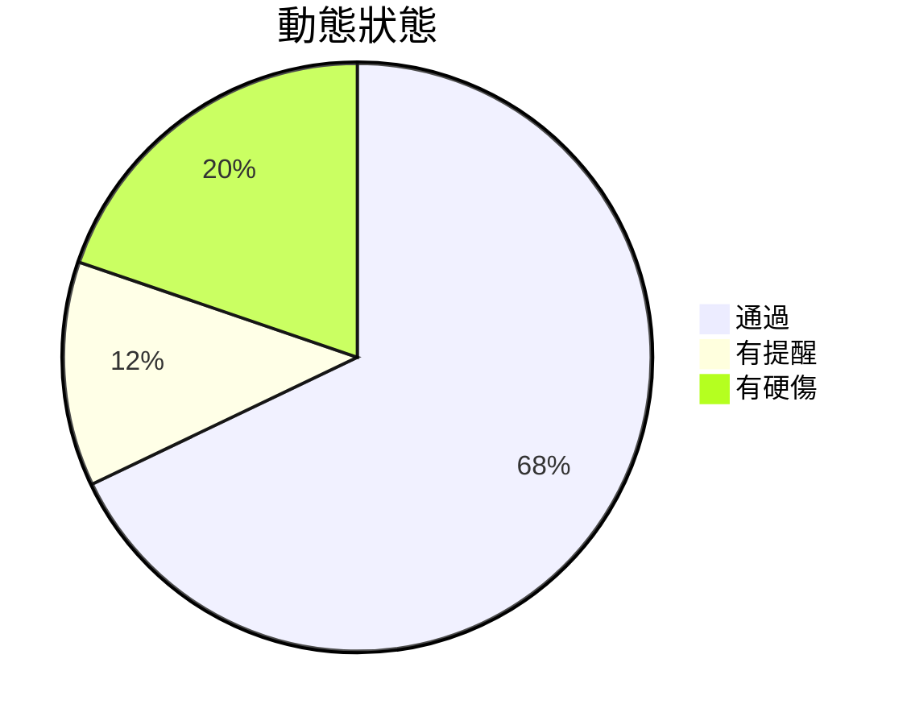

# 階段 2 · 動態檢查報告（區 0,A,D,E,F,H）

> 自動產生（`cm_zone_dynamic.py`）。無頭 Edge 逐頁真的打開、按一輪安全按鈕、截圖。**只讀專案**。

- 模式：**file**（file＝與你的驗收口徑相同）｜資料：**全新空白（新用戶）**
- 範圍：區 0,A,D,E,F,H｜共 **81** 頁｜耗時 420 秒
- 圖例：✅ 通過　🟡 有提醒　❌ 有硬傷（載入失敗／JS 例外／按鈕按了就爆／畫面空白）

## 1. 總覽

| 區 | 頁數 | ✅ | 🟡 | ❌ |
|---|---|---|---|---|
| 0 | 47 | 26 | 9 | 12 |
| A | 7 | 3 | 0 | 4 |
| D | 6 | 5 | 1 | 0 |
| E | 13 | 13 | 0 | 0 |
| F | 6 | 6 | 0 | 0 |
| H | 2 | 2 | 0 | 0 |

## 2. ❌ 有硬傷（16 頁）

| 區 | 頁面 | 問題 | 截圖 |
|---|---|---|---|
| 0 | `church_ministry/modules/media/audio-team.html` | 按『📂 本區完整側欄』出錯：Uncaught SyntaxError: Identifier 'ChurchMasterDatabase' has already been declared @ church-master-database.js:1 | [圖](screens/0-a-d-e-f-h_file_empty/church_ministry_modules_media_audio-team_html_6110de.jpg) |
| 0 | `church_ministry/modules/media/live-streaming.html` | 按『📂 本區完整側欄』出錯：Uncaught SyntaxError: Identifier 'ChurchMasterDatabase' has already been declared @ church-master-database.js:1 | [圖](screens/0-a-d-e-f-h_file_empty/church_ministry_modules_media_live-streaming_html_6fee7d.jpg) |
| 0 | `church_ministry/modules/worship/congregational-songs.html` | 按『📂 本區完整側欄』出錯：Uncaught SyntaxError: Identifier 'ChurchMasterDatabase' has already been declared @ church-master-database.js:1 | [圖](screens/0-a-d-e-f-h_file_empty/church_ministry_modules_worship_congregational-songs_html_f137c1.jpg) |
| 0 | `church_ministry/modules/worship/hospitality.html` | 按『📂 本區完整側欄』出錯：Uncaught SyntaxError: Identifier 'ChurchMasterDatabase' has already been declared @ church-master-database.js:1 | [圖](screens/0-a-d-e-f-h_file_empty/church_ministry_modules_worship_hospitality_html_af9ddd.jpg) |
| 0 | `church_ministry/modules/worship/pulpit-ministry.html` | 按『📂 本區完整側欄』出錯：Uncaught SyntaxError: Identifier 'ChurchMasterDatabase' has already been declared @ church-master-database.js:1 | [圖](screens/0-a-d-e-f-h_file_empty/church_ministry_modules_worship_pulpit-ministry_html_9d3092.jpg) |
| 0 | `church_ministry/modules/worship/sermon-notes-admin.html` | 按『📂 本區完整側欄』出錯：Uncaught SyntaxError: Identifier 'ChurchMasterDatabase' has already been declared @ church-master-database.js:1 | [圖](screens/0-a-d-e-f-h_file_empty/church_ministry_modules_worship_sermon-notes-admin_html_8a3c05.jpg) |
| 0 | `church_ministry/modules/worship/sheet-music.html` | 按『📂 本區完整側欄』出錯：Uncaught SyntaxError: Identifier 'ChurchMasterDatabase' has already been declared @ church-master-database.js:1 | [圖](screens/0-a-d-e-f-h_file_empty/church_ministry_modules_worship_sheet-music_html_6b83f8.jpg) |
| 0 | `church_ministry/modules/worship/worship-integrated.html` | JS 例外：Uncaught SyntaxError: Identifier 'ChurchMasterDatabase' has already been declared @ church-master-database.js:1；按『📂 本區完整側欄』出錯：Uncaught SyntaxError: Identifier 'ChurchMasterDatabase' has already  | [圖](screens/0-a-d-e-f-h_file_empty/church_ministry_modules_worship_worship-integrated_html_1a8b6f.jpg) |
| 0 | `church_ministry/modules/worship/worship-management.html` | 按『📂 本區完整側欄』出錯：Uncaught SyntaxError: Identifier 'ChurchMasterDatabase' has already been declared @ church-master-database.js:1 | [圖](screens/0-a-d-e-f-h_file_empty/church_ministry_modules_worship_worship-management_html_b66841.jpg) |
| 0 | `church_ministry/people/people_list.html` | 按『📊 總覽』出錯：ReferenceError: switchTab is not defined @ people_list.html:63 | [圖](screens/0-a-d-e-f-h_file_empty/church_ministry_people_people_list_html_851394.jpg) |
| 0 | `church_planning/assessment-os-hub.html` | 按『→ 信徒靈命健康』出錯：SyntaxError: Failed to execute 'click' on 'HTMLElement': Unexpected end of input @ assessment-os-hub.html:76 | [圖](screens/0-a-d-e-f-h_file_empty/church_planning_assessment-os-hub_html_00a651.jpg) |
| 0 | `church_planning/cta-os-war-room.html` | 按『→ 領袖健康診斷』出錯：SyntaxError: Failed to execute 'click' on 'HTMLElement': Unexpected end of input @ cta-os-war-room.html:79 | [圖](screens/0-a-d-e-f-h_file_empty/church_planning_cta-os-war-room_html_b08832.jpg) |
| A | `church_ministry/modules/worship/choir-team.html` | 按『📂 本區完整側欄』出錯：Uncaught SyntaxError: Identifier 'ChurchMasterDatabase' has already been declared @ church-master-database.js:1 | [圖](screens/0-a-d-e-f-h_file_empty/church_ministry_modules_worship_choir-team_html_caa907.jpg) |
| A | `church_ministry/modules/worship/instrument-team.html` | 按『📂 本區完整側欄』出錯：Uncaught SyntaxError: Identifier 'ChurchMasterDatabase' has already been declared @ church-master-database.js:1 | [圖](screens/0-a-d-e-f-h_file_empty/church_ministry_modules_worship_instrument-team_html_42f1a0.jpg) |
| A | `church_ministry/modules/worship/song-library.html` | 按『📂 本區完整側欄』出錯：Uncaught SyntaxError: Identifier 'ChurchMasterDatabase' has already been declared @ church-master-database.js:1 | [圖](screens/0-a-d-e-f-h_file_empty/church_ministry_modules_worship_song-library_html_bd7662.jpg) |
| A | `church_ministry/modules/worship/worship-team-management.html` | 按『📂 本區完整側欄』出錯：Uncaught SyntaxError: Identifier 'ChurchMasterDatabase' has already been declared @ church-master-database.js:1 | [圖](screens/0-a-d-e-f-h_file_empty/church_ministry_modules_worship_worship-team-management_html_d2690f.jpg) |

## 3. 🟡 有提醒（10 頁）

| 區 | 頁面 | 提醒 |
|---|---|---|
| 0 | `church_ministry/modules/expansion/cross-cultural.html` | 主控台錯誤 2：Failed to load resource: net::ERR_FILE_NOT_FOUND file:///C:/Users/hlch…cursor/bible100_new/church_ministry/assets/webfonts/fa-solid-900.woff2；網路失敗 2：net::ERR_FILE_NOT_FOUND |
| 0 | `church_ministry/modules/innovation/new-media.html` | 主控台錯誤 2：Failed to load resource: net::ERR_FILE_NOT_FOUND file:///C:/Users/hlch…cursor/bible100_new/church_ministry/assets/webfonts/fa-solid-900.woff2；網路失敗 2：net::ERR_FILE_NOT_FOUND |
| 0 | `church_ministry/modules/research/growth-trends.html` | 主控台錯誤 2：Failed to load resource: net::ERR_FILE_NOT_FOUND file:///C:/Users/hlch…cursor/bible100_new/church_ministry/assets/webfonts/fa-solid-900.woff2；網路失敗 2：net::ERR_FILE_NOT_FOUND |
| 0 | `church_ministry/modules/research/member-statistics.html` | 主控台錯誤 2：Access to script at 'https://kit.fontawesome.com/a076d05399.js' from o…trol-Allow-Origin' header is present on the requested resource. file:/；網路失敗 1：net::ERR_FAILED |
| 0 | `church_ministry/modules/research/ministry-performance.html` | 主控台錯誤 2：Failed to load resource: net::ERR_FILE_NOT_FOUND file:///C:/Users/hlch…cursor/bible100_new/church_ministry/assets/webfonts/fa-solid-900.woff2；網路失敗 2：net::ERR_FILE_NOT_FOUND |
| 0 | `church_ministry/modules/support/smart-reminders.html` | 主控台錯誤 2：Failed to load resource: net::ERR_FILE_NOT_FOUND file:///C:/Users/hlch…cursor/bible100_new/church_ministry/assets/webfonts/fa-solid-900.woff2；網路失敗 2：net::ERR_FILE_NOT_FOUND |
| 0 | `church_ministry/modules/support/workflow.html` | 主控台錯誤 2：Failed to load resource: net::ERR_FILE_NOT_FOUND file:///C:/Users/hlch…cursor/bible100_new/church_ministry/assets/webfonts/fa-solid-900.woff2；網路失敗 2：net::ERR_FILE_NOT_FOUND |
| 0 | `church_ministry/modules/tech/ai-assistant.html` | 主控台錯誤 2：Failed to load resource: net::ERR_FILE_NOT_FOUND file:///C:/Users/hlch…cursor/bible100_new/church_ministry/assets/webfonts/fa-solid-900.woff2；網路失敗 2：net::ERR_FILE_NOT_FOUND |
| 0 | `church_ministry/people/person_detail.html` | 主控台錯誤 4：Access to fetch at 'file:///C:/Users/hlche/.cursor/bible100_new/church…en blocked by CORS policy: Cross origin requests are only supported fo；網路失敗 2：net::ERR_FAILED |
| D | `church_ministry/modules/mission/mission-ministry.html` | 畫面出現 undefined |

## 4. 問題類型統計

| 類型 | 頁數 |
|---|---|
| 按『📂 本區完整側欄』出錯 | 13 |
| 主控台錯誤 2 | 8 |
| 網路失敗 2 | 8 |
| 網路失敗 1 | 1 |
| JS 例外 | 1 |
| 按『📊 總覽』出錯 | 1 |
| 主控台錯誤 4 | 1 |
| 按『→ 信徒靈命健康』出錯 | 1 |
| 按『→ 領袖健康診斷』出錯 | 1 |
| 畫面出現 undefined | 1 |

## 5. 限制

- 只按「安全」按鈕（略過刪除／清除／匯入／下載等），不填表單、不送出；所以**存檔後是否還在**這類流程，要靠階段 3 與真人試用。
- 「好不好懂」「用語是否合適」機器判斷不了，交給中立 AI 盲測與牧者。