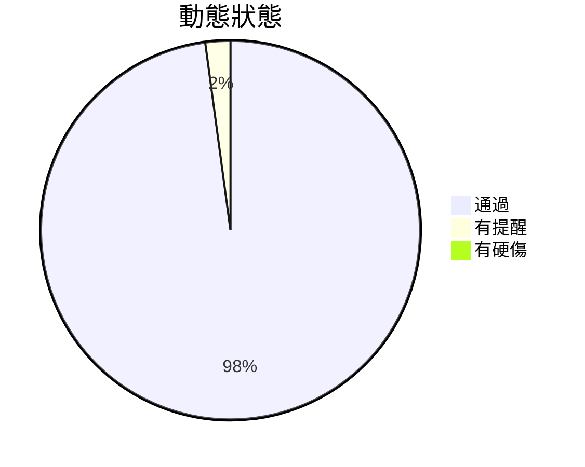

# 階段 2 · 動態檢查報告（區 0）

> 自動產生（`cm_zone_dynamic.py`）。無頭 Edge 逐頁真的打開、按一輪安全按鈕、截圖。**只讀專案**。

- 模式：**file**（file＝與你的驗收口徑相同）｜資料：**全新空白（新用戶）**
- 範圍：區 0｜共 **47** 頁｜耗時 271 秒
- 圖例：✅ 通過　🟡 有提醒　❌ 有硬傷（載入失敗／JS 例外／按鈕按了就爆／畫面空白）

## 1. 總覽

| 區 | 頁數 | ✅ | 🟡 | ❌ |
|---|---|---|---|---|
| 0 | 47 | 46 | 1 | 0 |

## 2. ❌ 有硬傷（0 頁）

- 無

## 3. 🟡 有提醒（1 頁）

| 區 | 頁面 | 提醒 |
|---|---|---|
| 0 | `church_ministry/people/person_detail.html` | 主控台錯誤 4：Access to fetch at 'file:///C:/Users/hlche/.cursor/bible100_new/church…en blocked by CORS policy: Cross origin requests are only supported fo；網路失敗 2：net::ERR_FAILED |

## 4. 問題類型統計

| 類型 | 頁數 |
|---|---|
| 主控台錯誤 4 | 1 |
| 網路失敗 2 | 1 |

## 5. 限制

- 只按「安全」按鈕（略過刪除／清除／匯入／下載等），不填表單、不送出；所以**存檔後是否還在**這類流程，要靠階段 3 與真人試用。
- 「好不好懂」「用語是否合適」機器判斷不了，交給中立 AI 盲測與牧者。