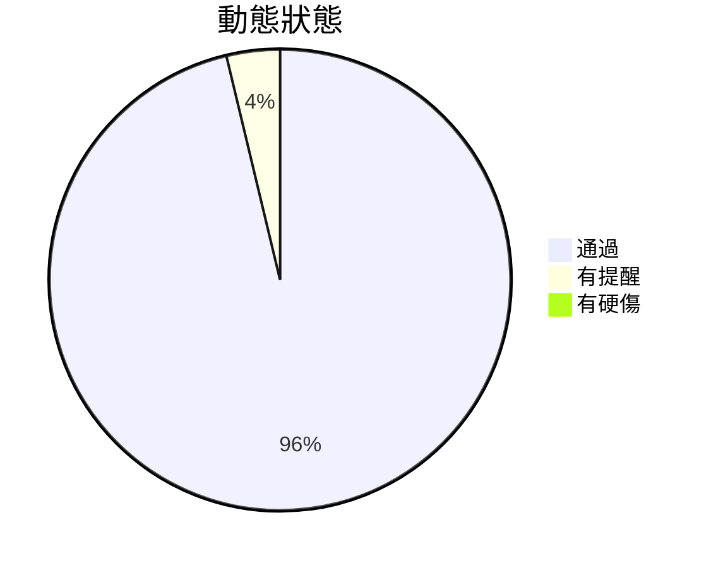

# 階段 2 · 動態檢查報告（區 ALL）

> 自動產生（`cm_zone_dynamic.py`）。無頭 Edge 逐頁真的打開、按一輪安全按鈕、截圖。**只讀專案**。

- 模式：**file**（file＝與你的驗收口徑相同）｜資料：**全新空白（新用戶）**
- 範圍：區 ALL｜共 **188** 頁｜耗時 948 秒
- 圖例：✅ 通過　🟡 有提醒　❌ 有硬傷（載入失敗／JS 例外／按鈕按了就爆／畫面空白）

## 1. 總覽

| 區 | 頁數 | ✅ | 🟡 | ❌ |
|---|---|---|---|---|
| 0 | 47 | 46 | 1 | 0 |
| ? | 17 | 15 | 2 | 0 |
| A | 7 | 7 | 0 | 0 |
| B | 38 | 37 | 1 | 0 |
| C | 16 | 15 | 1 | 0 |
| D | 6 | 5 | 1 | 0 |
| E | 13 | 13 | 0 | 0 |
| F | 6 | 6 | 0 | 0 |
| G | 36 | 34 | 1 | 1 |
| H | 2 | 2 | 0 | 0 |

## 2. ❌ 有硬傷（1 頁）

| 區 | 頁面 | 問題 | 截圖 |
|---|---|---|---|
| G | `church_planning/ministry-position-matchmaker.html` | 畫面空白 | [圖](screens/all_file_empty/) |

## 3. 🟡 有提醒（7 頁）

| 區 | 頁面 | 提醒 |
|---|---|---|
| 0 | `church_ministry/people/person_detail.html` | 主控台錯誤 4：Access to fetch at 'file:///C:/Users/hlche/.cursor/bible100_new/church…en blocked by CORS policy: Cross origin requests are only supported fo；網路失敗 2：net::ERR_FAILED |
| ? | `church_ministry/dashboard_church_layout_v1_content.html` | 主控台錯誤 4：Failed to load resource: net::ERR_FILE_NOT_FOUND file:///C:/Users/hlch…ursor/bible100_new/docs/image_b100_site/06_church_admin_l3_actions.png；網路失敗 3：net::ERR_FILE_NOT_FOUND；壞圖 2 |
| ? | `church_ministry/index.html` | 頁內有 contentFrame（殼中殼？） |
| B | `church_ministry/tools/visitation_followup/setting.html` | 畫面出現 [object Object] |
| C | `bible_study/comprehensive_exegesis_reader.html` | 主控台錯誤 564：Access to fetch at 'file:///C:/Users/hlche/.cursor/bible100_new/data/b…ked by CORS policy: Cross origin requests are only supported for proto；網路失敗 282：net::ERR_FAILED |
| D | `church_ministry/modules/mission/mission-ministry.html` | 畫面出現 undefined |
| G | `church_ministry/admin/cloud_login.html` | 主控台錯誤 1：Failed to load resource: net::ERR_FILE_NOT_FOUND file:///C:/Users/hlche/.cursor/bible100_new/css/church_ministry_ui.css；網路失敗 1：net::ERR_FILE_NOT_FOUND |

## 4. 問題類型統計

| 類型 | 頁數 |
|---|---|
| 主控台錯誤 4 | 2 |
| 網路失敗 2 | 1 |
| 網路失敗 3 | 1 |
| 壞圖 2 | 1 |
| 頁內有 contentFrame（殼中殼？） | 1 |
| 畫面出現 [object Object] | 1 |
| 主控台錯誤 564 | 1 |
| 網路失敗 282 | 1 |
| 畫面出現 undefined | 1 |
| 主控台錯誤 1 | 1 |
| 網路失敗 1 | 1 |
| 畫面空白 | 1 |

## 5. 限制

- 只按「安全」按鈕（略過刪除／清除／匯入／下載等），不填表單、不送出；所以**存檔後是否還在**這類流程，要靠階段 3 與真人試用。
- 「好不好懂」「用語是否合適」機器判斷不了，交給中立 AI 盲測與牧者。