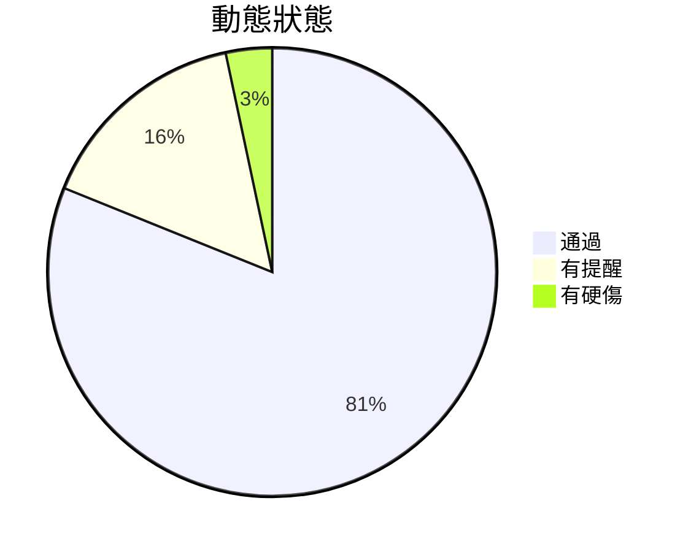

# 階段 2 · 動態檢查報告（區 B,C,G）

> 自動產生（`cm_zone_dynamic.py`）。無頭 Edge 逐頁真的打開、按一輪安全按鈕、截圖。**只讀專案**。

- 模式：**file**（file＝與你的驗收口徑相同）｜資料：**已載入示範會友**
- 範圍：區 B,C,G｜共 **90** 頁｜耗時 414 秒
- 圖例：✅ 通過　🟡 有提醒　❌ 有硬傷（載入失敗／JS 例外／按鈕按了就爆／畫面空白）

## 1. 總覽

| 區 | 頁數 | ✅ | 🟡 | ❌ |
|---|---|---|---|---|
| B | 38 | 34 | 3 | 1 |
| C | 16 | 15 | 1 | 0 |
| G | 36 | 24 | 10 | 2 |

## 2. ❌ 有硬傷（3 頁）

| 區 | 頁面 | 問題 | 截圖 |
|---|---|---|---|
| B | `church_ministry/modules/fellowship/pastoral-integrated.html` | 按『開始今晚點名 →』出錯：SecurityError: Failed to read a named property 'PastoralIntegratedShell' from 'Window': Blocked a frame with origin "null" from accessing a cross-origin frame. @ attendance-checkin.html? | [圖](screens/b-c-g_file_seed/church_ministry_modules_fellowship_pastoral-integrated_html_f6f898.jpg) |
| G | `church_ministry/dashboard.html` | 按『目錄搜索』出錯：Uncaught SyntaxError: missing ) after argument list @ global-tools.js:246 | [圖](screens/b-c-g_file_seed/church_ministry_dashboard_html_4328fd.jpg) |
| G | `church_ministry/modules/research/advanced-reports.html` | 按『取消』出錯：TypeError: Cannot read properties of null (reading 'reset') @ advanced-reports.html:369 | [圖](screens/b-c-g_file_seed/church_ministry_modules_research_advanced-reports_html_477692.jpg) |

## 3. 🟡 有提醒（14 頁）

| 區 | 頁面 | 提醒 |
|---|---|---|
| B | `church_ministry/modules/fellowship/index.html` | 主控台錯誤 2：Failed to load resource: net::ERR_FILE_NOT_FOUND file:///C:/Users/hlch…100_new/church_ministry/modules/fellowship/assets/css/tailwind.min.css；網路失敗 2：net::ERR_FILE_NOT_FOUND |
| B | `church_ministry/modules/fellowship/visitation.html` | 主控台錯誤 2：Failed to load resource: net::ERR_FILE_NOT_FOUND file:///C:/Users/hlch…100_new/church_ministry/modules/fellowship/assets/css/tailwind.min.css；網路失敗 2：net::ERR_FILE_NOT_FOUND |
| B | `church_ministry/tools/visitation_followup/setting.html` | 畫面出現 [object Object] |
| C | `bible_study/comprehensive_exegesis_reader.html` | 主控台錯誤 564：Access to fetch at 'file:///C:/Users/hlche/.cursor/bible100_new/data/b…ked by CORS policy: Cross origin requests are only supported for proto；網路失敗 282：net::ERR_FAILED |
| G | `church_ministry/admin/cloud_login.html` | 主控台錯誤 1：Failed to load resource: net::ERR_FILE_NOT_FOUND file:///C:/Users/hlche/.cursor/bible100_new/css/church_ministry_ui.css；網路失敗 1：net::ERR_FILE_NOT_FOUND |
| G | `church_ministry/modules/research/activity-performance.html` | 主控台錯誤 2：Failed to load resource: net::ERR_FILE_NOT_FOUND file:///C:/Users/hlch…cursor/bible100_new/church_ministry/assets/webfonts/fa-solid-900.woff2；網路失敗 2：net::ERR_FILE_NOT_FOUND |
| G | `church_ministry/modules/research/activity-statistics.html` | 主控台錯誤 2：Access to script at 'https://kit.fontawesome.com/a076d05399.js' from o…trol-Allow-Origin' header is present on the requested resource. file:/；網路失敗 1：net::ERR_FAILED |
| G | `church_ministry/modules/research/effectiveness-trends.html` | 主控台錯誤 2：Failed to load resource: net::ERR_FILE_NOT_FOUND file:///C:/Users/hlch…cursor/bible100_new/church_ministry/assets/webfonts/fa-solid-900.woff2；網路失敗 2：net::ERR_FILE_NOT_FOUND |
| G | `church_ministry/modules/research/financial-statistics.html` | 主控台錯誤 2：Access to script at 'https://kit.fontawesome.com/a076d05399.js' from o…trol-Allow-Origin' header is present on the requested resource. file:/；網路失敗 1：net::ERR_FAILED |
| G | `church_ministry/modules/research/participation-trends.html` | 主控台錯誤 2：Failed to load resource: net::ERR_FILE_NOT_FOUND file:///C:/Users/hlch…cursor/bible100_new/church_ministry/assets/webfonts/fa-solid-900.woff2；網路失敗 2：net::ERR_FILE_NOT_FOUND |
| G | `church_ministry/modules/research/performance-evaluation.html` | 主控台錯誤 2：Access to script at 'https://kit.fontawesome.com/a076d05399.js' from o…trol-Allow-Origin' header is present on the requested resource. file:/；網路失敗 1：net::ERR_FAILED |
| G | `church_ministry/modules/research/statistical-reports.html` | 主控台錯誤 2：Failed to load resource: net::ERR_FILE_NOT_FOUND file:///C:/Users/hlch…cursor/bible100_new/church_ministry/assets/webfonts/fa-solid-900.woff2；網路失敗 2：net::ERR_FILE_NOT_FOUND |
| G | `church_ministry/modules/research/trend-analysis.html` | 主控台錯誤 2：Access to script at 'https://kit.fontawesome.com/a076d05399.js' from o…trol-Allow-Origin' header is present on the requested resource. file:/；網路失敗 1：net::ERR_FAILED |
| G | `church_ministry/modules/research/volunteer-performance.html` | 主控台錯誤 2：Failed to load resource: net::ERR_FILE_NOT_FOUND file:///C:/Users/hlch…cursor/bible100_new/church_ministry/assets/webfonts/fa-solid-900.woff2；網路失敗 2：net::ERR_FILE_NOT_FOUND |

## 4. 問題類型統計

| 類型 | 頁數 |
|---|---|
| 主控台錯誤 2 | 12 |
| 網路失敗 2 | 8 |
| 網路失敗 1 | 5 |
| 按『開始今晚點名 →』出錯 | 1 |
| 畫面出現 [object Object] | 1 |
| 主控台錯誤 564 | 1 |
| 網路失敗 282 | 1 |
| 主控台錯誤 1 | 1 |
| 按『目錄搜索』出錯 | 1 |
| 按『取消』出錯 | 1 |

## 5. 限制

- 只按「安全」按鈕（略過刪除／清除／匯入／下載等），不填表單、不送出；所以**存檔後是否還在**這類流程，要靠階段 3 與真人試用。
- 「好不好懂」「用語是否合適」機器判斷不了，交給中立 AI 盲測與牧者。