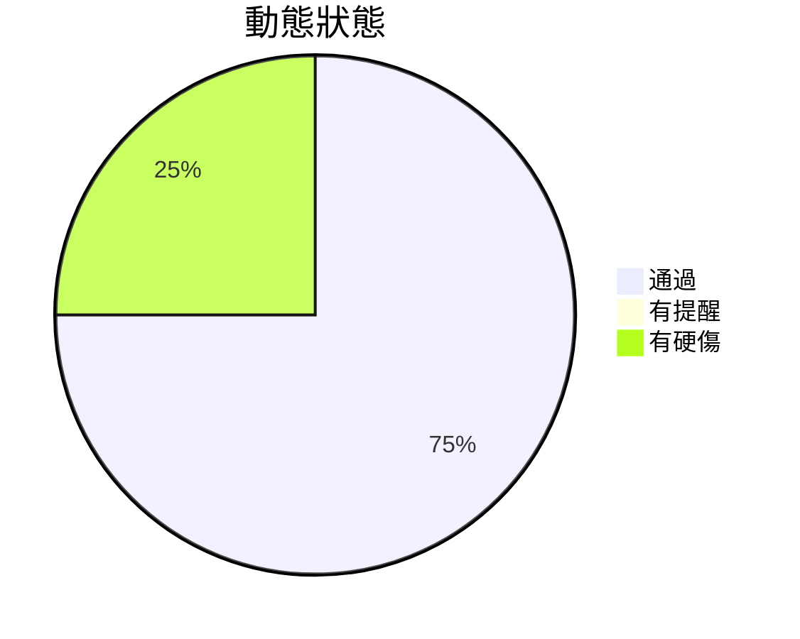

# 階段 2 · 動態檢查報告（區 B）

> 自動產生（`cm_zone_dynamic.py`）。無頭 Edge 逐頁真的打開、按一輪安全按鈕、截圖。**只讀專案**。

- 模式：**file**（file＝與你的驗收口徑相同）｜資料：**全新空白（新用戶）**
- 範圍：區 B｜共 **4** 頁｜耗時 10 秒
- 圖例：✅ 通過　🟡 有提醒　❌ 有硬傷（載入失敗／JS 例外／按鈕按了就爆／畫面空白）

## 1. 總覽

| 區 | 頁數 | ✅ | 🟡 | ❌ |
|---|---|---|---|---|
| B | 4 | 3 | 0 | 1 |

## 2. ❌ 有硬傷（1 頁）

| 區 | 頁面 | 問題 | 截圖 |
|---|---|---|---|
| B | `church_ministry/modules/fellowship/fellowship-circles.html` | JS 例外：Uncaught ReferenceError: global is not defined | [圖](screens/b_file_empty/) |

## 3. 🟡 有提醒（0 頁）

- 無

## 4. 問題類型統計

| 類型 | 頁數 |
|---|---|
| JS 例外 | 1 |

## 5. 限制

- 只按「安全」按鈕（略過刪除／清除／匯入／下載等），不填表單、不送出；所以**存檔後是否還在**這類流程，要靠階段 3 與真人試用。
- 「好不好懂」「用語是否合適」機器判斷不了，交給中立 AI 盲測與牧者。