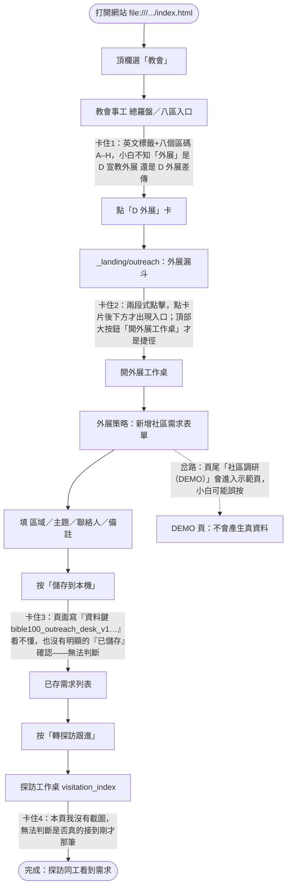

# 教會事工 · 盲測報告（小白視角）

- 檢測身份：第一次接手教會行政的志工，不懂電腦術語，只會照畫面做
- 範圍：`blind_input.md` 列出的 9 區、25 頁（截圖全看；HTML 只實際讀了 4 頁：`_landing/education.html`、`modules/fellowship/index.html`、`guide_crm_trial_30min.html`、`modules/expansion/outreach-strategy.html`。其餘頁的「按鈕背後有沒有功能」只能依截圖判斷，標「無法判斷」）
- 重要限制：多張截圖是捲到頁面中段才拍（例如 A-1、B-1、D-1、H-1 的頂部被切掉），我看不到「第一眼」完整畫面，這些頁的「第一眼分數」只代表截圖可見範圍。
- 「—」代表我沒看到問題或無法判斷，不代表沒有問題。

---

## A. 頁面表

分數 1-5（5＝小白第一眼知道按哪）。嚴重度：P0 資料壞/洩漏｜P1 主要功能不能用/誤導｜P2 能用但易錯或看不懂｜P3 小瑕疵。

| 區 | 頁面 | 用途（我的理解） | 第一眼 | 可完成任務？ | 問題（附證據） | 嚴重度 |
|---|---|---|---|---|---|---|
| 0 | `ai_tools/pages/crm_automation_console.html` | 口述一句話，讓 AI 幫你填表草稿（排班、探訪、對帳） | 2 | 部分 | 頂條「訪后口述 → AI 整理成表單字段草稿 → 同工确认后手动存入 CRM」「→ AI 路線圖」為簡體混繁體；「4F 是入口，5F 是減壓閥」「屏 1 · 你在整棟 CRM 大樓的哪一層？」「Aha 時刻」是比喻＋術語，小白不懂「CRM」「5F」；右上「✓ 試用版 · AI 模擬」沒說「模擬」是指什麼；三張卡各有一顆「👉 一鍵帶入範例句」，看不出哪個是正式功能 | P2 |
| 0 | `church_ministry/_landing/education.html` | C 教育培訓的入口：下方選 Tab 再進主日學 | 3 | 部分 | 標題「C 教育培訓」下副標「Teach」「SS desk」「Compass」「Guide/Roster/Attend」英文夾雜；「回總羅盤」「開教育工作桌」兩顆按鈕近似，不知差在哪；「點一項 → 下方出現可進的頁面」＝要點兩次才進得去，截圖下方又有「打開備課 Tab」「聖經研讀 跨模組」，不知哪個才是目標；HTML 為「載入中…」＋JS 動態生成（`cm_compass_shell.js`），本頁自己沒有可檢查的按鈕實作 | P2 |
| 0 | `church_ministry/guide_crm_trial_30min.html` | 標題是「CRM 30 分鐘試玩地圖」，但實際會被轉到「教會選路／八區入口」 | 2 | 無法判斷 | HTML `<meta http-equiv="refresh" content="0;url=_landing/gateway.html">` 且 `<title>轉到教會選路（舊 CRM 試玩已退役）</title>`，但內文仍留著完整「路徑 A/B/C」；截圖顯示的是「八區入口」，並非 30 分鐘試玩內容 → 檔名與看到的畫面不一致；八區入口中 B 卡是氣球狀、C 卡是歪斜形，圖形不一致；「事奉配對 事工需求單」連結字很小；晶片「主日 Sunday／關懷 Care／教導 Teach／點名 Attend」中英並列且不知與下方八區的關係 | P2 |
| A | `_landing/worship.html` | A 敬拜音樂入口：先開主日工作桌，再管詩班 | 3 | 部分 | 步驟卡全是「Desk／Choir／Hymns／Compass」英文小標；「聖詩深工 換到 F 區」「回總羅盤 換區」小白不懂「F 區」「總羅盤」；底部再出現「教會總羅盤」卡，與上方「回總羅盤」重複；「點步，路線出現在下方」＝兩段式點擊 | P2 |
| A | `modules/worship/choir-team.html` | 詩班：成員、聲部、事工流程表 | 2 | 部分 | 簡繁混雜：「事工流程表（年度 / 导师 / 练习 / 编配 / 演出 / 培训 / 汇报）」「后期模块互联（预告）」；顯示給使用者的程式名詞：「資料鍵 church_ministry_choir_flow_v1」「memberId ↔ churchMasterDatabase」「worship_crm_intents_v1」「guide_crm_journey_hub?tab=matchmaker」「sheet-music」；「（尚無草稿）」「W2 CRM 實驗」「W3 樞紐」；表格中已有「新團員 12 人／示範」「01/05/2026 講譜與發聲」，在「空白新資料」截圖卻已有資料，看起來像真的；每列有「刪」鈕，是否二次確認無法判斷 | P1（假資料）／P2（術語） |
| A | `modules/worship/instrument-team.html` | 樂團管理：成員、樂器清單、排班、曲目 | 2 | 部分 | 標題「器乐团队管理系统」「乐器清单」「购买日期」「负责人」簡體；空白狀態卻有「電吉他 Fender Stratocaster 李弟兄」「電子琴 Yamaha PSR 王姊妹」「架子鼓 Roland V-Drums 張兄弟」＋「刪除」鈕——看起來像真資料；「記憶：memberId ↔ memberSystemData」「guide_crm_journey_hub」等程式名；「設備ID EQ001」未說明 | P1／P2 |
| B | `_landing/pastoral.html` | B 牧養關懷入口：牧養整合、探訪、預警、豐盛金齡 | 2 | 部分 | 卡片被畫成水滴／長條不規則形（「預警」是一條細長斜形），像破圖；英文小標 Desk／Visit／Alerts／Golden Age；「豐盛金齡」下的「知情同意 Consent W0」「失敗指標／停損 Failsafe W0」「轉介資源 Referral W1」——「W0／W1」是工程進度代號，小白不懂；「失敗指標／停損」是財務/工程語；「打開金齡安全門 Hub 主入口」不知是什麼 | P2 |
| B | `modules/fellowship/fellowship-circles.html` | 小組一覽：找你的團契／小組，進小組工作桌 | 3 | 部分 | 標題「团契的圈 · 找你的家」「Hub 矩阵统计（pastoral_org_v1）」「CRM 怎样帮？」簡繁混；「B-10 報告」「名冊約 0 人／0 組」（空狀態合理但「名冊約」不明）；「青年團契 · 名冊約 0 人 / 0 組」卻有「社青職場圈 6 人／1 組」、「夫婦團契 1 人」——空白資料下為何有人無法判斷是否為示範；「北区邻里圈」沒有「名冊」字樣，格式不一；按鈕「青年團契活動／小組工作桌／探訪事工」意義依卡片不同，小白難預期 | P2 |
| B | `modules/fellowship/index.html` | 團契互動模組首頁（舊式功能介紹頁） | 1 | 否／無法判斷 | 截圖：頁首語言＝印尼文「Interaksi persekutuan」「Kembali ke pusat pelayanan」「Formulir tetap bahasa Cina…」，下方卻是繁體中文；整頁像沒套樣式（原生按鈕、標題 Times 字）；右上自動跳出藍色提示「團契統計 功能即將推出，敬請期待！」；HTML 內 `
3
`、`totalMembers 47`、`monthlyVisits 8`、`completionRate 85%` 是寫死的假數字；「最近活動 青年小組戶外活動 2024年2月15日」是假紀錄；「小組管理／探訪事工／探訪報表」標「已完成」，「社群論壇」標「開發中」，「相簿管理／團契統計」標「計劃中」→ 小白看到「進入模組」會以為都能用；`loadModule(...)` 實作在 300 行外，無法判斷；「B 區 Hub」「B-03 報告」是內部代號 | P1 |
| C | `ai_tools/sidebar_lab.html` | AI 輔助側欄（導讀備課 Prompt、創作、媒體教材、事工 AI） | 2 | 無法判斷 | 這是「側欄」，單獨打開右邊沒有內容；項目名「① 導讀 • 備課 • Prompt」「② 创作 • 图音视频 Prompt」「③ 媒体教材 • 嵌入工作流」簡繁混；「Vimeo · 图板」「Timestamp · 长片分段」「Legacy 全頁 · 進階向」「Lab 进阶目录」；「④ 事工 AI • 原頁 + HOW」不知「原頁」「HOW」是什麼；為何放在「C 聖經門訓」區而不是 AI 區，小白找不到理由 | P2 |
| C | `bible_study/comprehensive_exegesis_reader.html` | 讀「創世記 2 章」逐節注解＋禱告，可選書卷/章節，複製 AI Prompt | 4 | 是 | 頂部分頁「跑道／釋經／地理／多語／深研／創作／逐字」中英小標；左側綠色目錄「旧约综合解读／新约综合解读／认识千禧年／下载APP／下载电子版」是簡體，與頂欄繁體混；「CMC 釋經」縮寫沒說明；「同窗跑隊」、「回跑道」意義不明；黃條「適合已建立每日習慣的人。若你還在『敢開始』階段，建議先回 聖經跑道…」指引很好；內容真的有載入（有經文、圖、音檔播放器） | P3 |
| C | `bible_study/sidebar.html` | 聖經研讀側欄（經文工作台、譯本對照、全文搜尋…） | 2 | 無法判斷 | 單獨看是側欄；「譯本對照 parallel_mode_v3」把檔案代號當副標；黃條「經卷選用右欄工作台；釋經參演用下方 66 卷選單」但畫面下方沒有 66 卷選單；「逐字對照」展開後的項目「越 / 印逐字台 VI / ID workbench」（字首顯示不清，可能亂碼，需真人確認）；「釋經參演」「讀後創發」「跑道讀經」意義不直覺；「地理探索站 右欄點站點出發」「更多外站」下拉看不出會去哪 | P2 |
| D | `_landing/outreach.html` | D 宣教外展：需求登記 → 新人接待 → 交棒 | 3 | 部分 | 本頁標題為「D 宣教外展」，總站／清單卻叫「D 外展差傳」，兩個名字；「外展漏斗 Funnel」「交棒 Handoff 進門後交給 B 或 H」→ B、H 是什麼？（小白不知道 B＝牧養、H＝出席，要看卡片小字才知道）；階梯式三張卡錯位排列，視覺像破版；「開外展工作桌」按鈕存在，但本頁下方不是工作桌 | P2 |
| D | `modules/expansion/outreach-strategy.html` | 登記一筆社區需求（區域／主題／聯絡人／備註），再轉探訪 | 4 | 是 | 做得最像產品：表單、「儲存到本機」「載入一筆示範」「轉探訪跟進」「標記已結」「需求清單 CSV」都有 JS 實作（已讀 HTML）；頁面誠實寫「其餘 D 區子頁仍多為 DEMO」；扣分：「M6 LIVE 鏈」「真鏈步驟」「資料鍵：bible100_outreach_desk_v1（不上 getCrmMaturitySummary）」是工程師口吻；左上疊出一排很小的連結「D · 外展差傳｜回日常工作｜本區完整側欄｜載入試用會友」與頂欄重疊；「社區調研（DEMO）」按鈕本身承認是 DEMO；「回日常工作」用 `href="#"` + onclick | P2 |
| E | `_landing/social.html` | E 社關服事：先義工排班，再連會眾入口與牧養 | 3 | 部分 | 英文小標 Shifts／Center／Care／Nodes；「會眾入口 Church Center」與「接牧養 交棒 B」兩張膠囊卡，A、B 代號又出現；「回總羅盤」；本頁只有 3 個節點，卻佔滿整頁，看不出下一步 | P3 |
| E | `modules/volunteer/volunteer-integrated.html` | 志工管理：崗位、排班、培訓、績效 | 2 | 部分 | 預設停在最後一個 Tab「績效分析」，內容是空白圖表；「志工活躍度」「崗位飽和度」空白圖，但「服務時間分布」卻有 4 根彩色長條（約 30/38/25/13）——空白資料不該有數字；「需要關注 ✔ 所有志工服務狀態正常」在沒有任何志工時顯示「正常」＝誤導；文字「岗位饱和度」「服务时间分布」「需要关注」簡體；「會友名單請先載入示範會友」好；「入門怎麼做？①岗位管理…」步驟好，但小白預設看不到 | P1 |
| E | `tools/volunteer_shift/index.html` | 義工智能排班：先有人、有崗位 → 新增排班 → 複製邀請文字 | 2 | 部分 | 頁首一整段印尼文「Jadwal relawan cerdas」「Dasbor pelayanan」「Anda konfirmasi」「Bahasa 中/EN/VI/ID」＋英文「CTV suggests → you confirm」；步驟編號重複顯示「1. 1. 先有人…」「2. 2. 新增排班」「3. 3. 請假時到…」；「Hub-canonical · 寫入經 Hub Base / canonical API」「資料來源 volunteerSystemData.schedules」「目前模式：本機模式 · localStorage」「CTV promote」「Bridge」＝程式術語直接給小白看；「小白驗收檢查…」直接叫志工做「驗收」；七個頁籤（首頁／儀表板／新增排班…）有幫助 | P2 |
| F | `hymn_management/hymn_catalog_sort.html` | 1845 首聖詩目錄，可搜尋、依英文名排序 | 3 | 是 | 資料真的載入；問題：編號欄出現「0145,」「0146,」「0149,」尾巴逗號；「詩篇一三篇陈泽民 ( 0 PSALM_-103_1-13)」「0 PSALM_-103_1-13」是原始代碼外露；多列以「●」「▲」標記沒有圖例（如「● 華人詩歌」「▲ 世界名詩」「(●)」）；詩名「时已半夜橄榄山头」等簡繁混；說明「資料來自 default.htm」「手冊原索引仍在 hymn/default.htm（不改原文）」是工程文；曲調幾乎全是「—」 | P2 |
| F | `hymn_management/practical_hymnology/landing.html` | 實用聖詩學導覽：唱／懂／活／服 | 3 | 部分 | 截圖停在中段，頂部浮動列（找歌與譜／12 課主線…）遮住並疊在其下內容上（淡色半透明方塊露出來）；「樣本 · 奇異恩典帶領包 Leading pack」「hymn_most_0121」內部代號外露；「示範首可聽。沒有譜會明說」好；「AI 工具 複製提問；人要審」好；多張白卡只有標題一句，看不出按了會到哪（HTML 未讀，無法判斷） | P2 |
| G | `church_ministry/dashboard.html` | 教會事工儀表板（SPAC、健康度、PDCA） | 1 | 部分 | 首屏全是縮寫：「SPAC」「KPI 契約 v1 · source=development_bridge · generated_at=2026-11-24T17:20:21.301Z · skipped(att=0,sch=0,inc=0,fin=0)」「RBAC」「cloud_config USE_API + REQUIRE_AUTH，並至 admin/cloud_login.html 登入」「Plan → Do」「PDCA Check」；標題「Dasbor data」（印尼文）；頂列 chip 直接寫「index_v5」「全站工具說明」「目錄搜尋」；空白資料下卻顯示「4 週留存率 0% → PDCA Check」紅字告警與「就緒度 65%」；「教會規模：一戶／小型／中型／大型」按鈕不知要不要選；「功能與使用說明」是折疊的，預設看不到 | P2 |
| G | `modules/education/education-integrated.html` | 主日學工作桌（導覽／學籍／出席／門訓／備課 5 Tab） | 3 | 部分 | 空白資料截圖卻已顯示「3 班級、15 學員」「教師：陳弟兄 M1…李姊妹 M2…」＝像真人資料；`←15 主桌` 出現兩次（外層一次、內層 iframe 一次）；一排橘色大鈕（載入示範資料／匯出 JSON／匯入／名冊 CSV／出席 CSV…）小白不知該先按哪顆，「匯入」「匯出 JSON」按錯可能覆蓋資料；紫色說明條文字被按鈕遮住一部分（「這裡用 ▢ 裝備下一步」）；「Hub-canonical · 寫入經 Hub Base / canonical API」「externalId」「canonical」；右側兩個外層捲軸 | P1（假資料）／P2 |
| G | `modules/fellowship/newcomer-qr-desk.html` | 新人入場票：核對排隊的人 → 發 QR → 簽到 | 3 | 部分 | 截圖停在「示範新人」發碼彈窗（是否打開頁面就自動彈出無法判斷）；彈窗文字「好嘢！呢張長期票已經準備好」「而家未有新人排隊」「你而家喺」＝廣東話書面，與其他頁普通話書面混用；「B100|1001|6QCFB7」程式碼外露；「出席生產線 · 第 2/5 站」「我係：可以發碼（負責人）」權限下拉，小白不知選哪個；步驟列「填表／發碼／簽到／錄取」有用；彈窗按鈕「列印／存圖」「去開始今晚點名 →」「關閉」清楚 | P2 |
| H | `_landing/attendance.html` | H 出席系統入口：報到 → 看名冊 → 手冊 → 歸屬 | 3 | 部分 | 標語「三步做事：報到 → 看名冊 → 不懂先讀手冊」，但下方有 4 張卡（含「第 4 步 · 歸屬」），數字對不上；預設展開的是最後一張「第4步·歸屬」，不是第 1 步；卡片大標「Check-in／Roster／Guide／Belong」英文為主；「金齡安全門 Golden 可選」「新人自助登記 Register」「認識小組 Groups」；「牧養出席 名冊對齊」「營運手冊 怎麼用」 | P2 |
| H | `modules/fellowship/pastoral-attendance.html` | 聚會與出席統計：選小組、勾選今日流程、匯出 CSV | 3 | 部分 | 預設停在「Tab4 · 奉獻與資源」（財務摘要 0／0／0），不是出席，頁名卻叫「聚會與出席統計」；標題列「聚会与出席统计」簡體；「回測進度 0/4（勾選會留在本機）」「回測」是工程/測試用語，小白不懂；「資料檔：group_attendance_v1」「摘要：docs/ATTENDANCE_GOVERNANCE.md」把檔案路徑印在畫面；「探訪事工 0-02」代號；身分切換（小白／招待、小組長、輪班長、牧者／資深）有助；「要登記？→ 現場點名」綠鈕清楚 | P2 |
| H | `modules/worship/worship-sunday-desk.html` | 主日一桌：點名 → 缺席跟進 → 看數字 → 匯出 | 2 | 部分 | 空白資料下：右上圓環「100%」、畫面飄落彩帶紙屑、底部黑色提示「已全體出席 · 記得按存檔」，但「回測進度 0/4」、「本週數字 0%」→ 假成功／互相矛盾；「本頁向下開始點名」；頁面放在「H 出席系統」下，頁頂卻寫「A · 主日一桌」「崇拜登記站」，區碼搞混；「資料檔：attendanceRecords」「docs/ATTENDANCE_GOVERNANCE.md」外露 | P1 |

---

## B. 最嚴重的 3 個問題＋怎麼重現

### 1.（P1）空白資料卻顯示「成功／正常／有人」，小白分不出真假
- 證據：
  - `modules/worship/worship-sunday-desk.html`：進度 0/4、本週數字 0%，但圓環「100%」＋彩帶＋提示「已全體出席 · 記得按存檔」。
  - `modules/volunteer/volunteer-integrated.html`「績效分析」：沒有志工卻有 4 根長條，且寫「✔ 所有志工服務狀態正常」。
  - `modules/fellowship/index.html` HTML 內寫死「活躍小組 3、參與成員 47、本月探訪 8、完成率 85%」「2024年2月15日 青年小組戶外活動」。
  - `modules/worship/instrument-team.html`、`modules/education/education-integrated.html`：空白新資料下已有「李弟兄」「3 班級 15 學員」。
- 重現：用 `file://` 在全新瀏覽器（沒有任何資料）打開上述頁面。
- 風險：小白會以為資料已存在、或系統已記錄；若直接按「匯出 CSV／列印」，示範資料可能混進真實名冊（我無法驗證匯出內容，列入 E）。

### 2.（P2，影響面最大）語言與文字混亂：印尼文、英文、廣東話、簡體混在同一頁
- 證據：
  - `modules/fellowship/index.html` 頁首＝印尼文「Interaksi persekutuan」。
  - `tools/volunteer_shift/index.html`「Jadwal relawan cerdas」「Dasbor pelayanan」。
  - `dashboard.html`「Dasbor data」。
  - `modules/fellowship/newcomer-qr-desk.html`「好嘢！呢張長期票已經準備好」「而家未有新人排隊」。
  - 簡體：`choir-team`「导师/练习/编配」、`instrument-team`「乐器清单」、`volunteer-integrated`「岗位饱和度」、`pastoral-attendance`「聚会与出席统计」、`crm_automation_console`「访后口述」。
- 重現：打開上述任一頁，不必點擊，第一屏就看得到。
- 風險：小白會以為「這頁壞了／是別的系統」，也找不到可信任的主要入口。

### 3.（P2）工程師口吻與內部代號直接給志工看，且入口多為「兩段式點擊」
- 證據：
  - 「KPI 契約 v1 · source=development_bridge · …skipped(att=0,…)」（`dashboard.html`）。
  - 「資料鍵：bible100_outreach_desk_v1（不上 getCrmMaturitySummary）」（`outreach-strategy.html`）。
  - 「Hub-canonical · 寫入經 Hub Base / canonical API」「localStorage」「CTV promote」（`volunteer_shift`、`education-integrated`）。
  - 「docs/ATTENDANCE_GOVERNANCE.md」（`pastoral-attendance`、`worship-sunday-desk`）。
  - 「W0／W1」（`_landing/pastoral.html`）。
  - 「回測進度」。
  - 各區 `_landing` 都是「點一項 → 下方出現可進的頁面」，要點兩次才能進功能頁。
- 重現：任選 `dashboard.html` 或 `tools/volunteer_shift/index.html`，不捲動即可見。
- 風險：小白不敢按、或按錯（例如「匯入」「匯出 JSON」「載入示範資料」並排）。

---

## C. 各區分數（1-10）

| 區 | 分數 | 一句話理由 |
|---|---|---|
| 0 CRM旅程／總羅盤 | 3 | 有流程概念，但「CRM／4F／5F／Aha」小白看不懂，且 30 分鐘試玩頁檔名與實際畫面不符。 |
| A 敬拜音樂 | 3 | 詩班、樂團頁有真表單，但簡繁混雜、內部代號外露，空白狀態已預填人名。 |
| B 牧養小組 | 3 | 小組一覽可用，但 `fellowship/index` 是印尼文＋寫死假數字＋無樣式，等於半成品。 |
| C 聖經門訓 | 4 | 綜合解讀真的能讀，但兩個「側欄」被當成頁面，小白單獨打開看不到出路。 |
| D 外展差傳 | 5 | 外展策略是少數「填表→存→轉探訪」完整可走的真鏈，且誠實標示其餘為 DEMO。 |
| E 社會服務 | 3 | 排班有工具但印尼文、重複編號、術語多；志工頁空資料顯示「正常」會誤導。 |
| F 樂以載道 | 4 | 曲目庫資料真實豐富，但有代碼外露、標記無圖例、浮動列遮擋。 |
| G 規劃行政 | 3 | 儀表板縮寫密集、空白資料就亮紅字；主日學／新人 QR 有料但不知先按哪。 |
| H 出席系統 | 3 | 流程設計（身分切換、今日一件事）好，但預設 Tab 不對、「100%＋彩帶」在 0 資料時假成功。 |

**整體分數：3.4／10**（九區平均）
**我最不放心的一件事**：空白資料下出現「100% 全體出席」「所有志工服務狀態正常」「47 位成員」等假成功／假數字——志工會當真並且可能匯出給牧者。

---

## D. 小白「應該怎麼走」流程圖（典型任務：登記一位社區需求，轉給探訪同工）

---

## E. 無法判斷、需要真人驗證的事項

1. 各區 `_landing` 頁截圖多半是捲到中段，頁面最上方第一屏（標題、主要按鈕）實際長什麼樣，需真人從頁首看一次。
2. `fellowship/index.html`：`loadModule('groups')`、`loadModule('visitation')`、「進入模組」到底會載入什麼（實作在我可讀的 300 行之外）；右上「團契統計 功能即將推出」提示是自動跳出還是點擊後才出現。
3. `newcomer-qr-desk.html`：彈窗「示範新人 QR 6QCFB7」是頁面打開就自動出現，還是截圖工具點過「試發一張示範碼」。
4. 「匯出 CSV／JSON／列印」在空白資料下，是否把示範資料（李弟兄、新團員 12 人、15 學員）一起匯出。
5. 詩班、樂團、教師表格中的「刪／刪除」鈕是否有二次確認、是否可復原。
6. `education-integrated.html` 的「匯入」是覆蓋還是合併；按錯能否還原。
7. `outreach-strategy.html`「儲存到本機」後有沒有明顯成功提示；「轉探訪跟進」後的探訪工作桌是否真的帶入該筆需求。
8. `sidebar_lab.html`、`bible_study/sidebar.html` 在實際總站殼中（右欄）每個連結會打開什麼；以及「66 卷選單」是否在別處出現。
9. `bible_study/sidebar.html`「逐字對照」下的「越 / 印逐字台」第一字是否亂碼（截圖解析度不足）。
10. `guide_crm_trial_30min.html` 實際打開時，是停在「八區入口」還是閃一下 30 分鐘試玩內容再被轉走；轉向時間是否夠小白讀完。
11. 簡體字（「导师／岗位／聚会」）是刻意設計（例如多語教材）還是漏轉，需產品主人確認。
12. 各頁在手機／平板的版面（本次僅有桌機截圖）。
