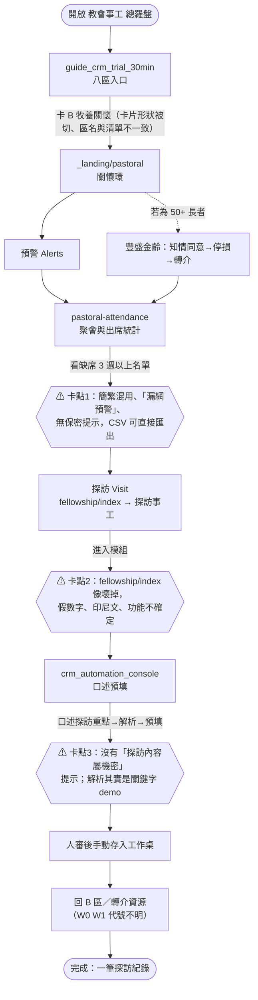

# 教會事工網站 · 盲測報告（學者視角：教義／牧養倫理／用語）

檢測依據：25 頁截圖（全部已看）＋ HTML 前 300 行（僅精讀 5 頁：`fellowship/index.html`、`newcomer-qr-desk.html`、`_landing/pastoral.html`、`fellowship-circles.html`、`crm_automation_console.html`；另對 `worship-sunday-desk.html`、`volunteer_shift/index.html` 各做單句字串查證）。其餘頁面的「按鈕背後有無功能」＝無法判斷。
說明：截圖多為「空白新資料」開啟；有些截圖停在頁面中段（頂部看不到），已在表中註明。

---

## A. 頁面表

分數＝學者第一眼知道要按哪裡（1–5）。

| 區 | 頁面 | 用途（一句） | 第一眼 | 可完成任務？ | 問題（附證據） | 嚴重度 |
|---|---|---|---|---|---|---|
| 0 | `ai_tools/pages/crm_automation_console.html` | 口述／貼上探訪或排班需求 → 解析成表單草稿 → 預填（不儲存） | 4 | 部分 | ✔ 頂欄寫「不自動寫入、不取代牧者判斷」「AI 看見與提醒，人只做愛與決定」，AI 需人審標示清楚。✘ 簡繁混用：頂欄「探访后口述 → AI 整理成表单字段草稿 → 同工确认后手动存入 CRM」；✘ 劇本「探訪記錄難整理：整理成關懷化跟進草稿」（「關懷化」不通）；✘ 首屏無「探訪內容屬牧養機密、勿貼可識別身分資料」提示（HTML 讀到 `crmIntentText` placeholder 只舉排班例；信任徽章只講寫入/通知，未講機密）；✘「4F 是入口，5F 是減壓閥…泡杯咖啡」大樓隱喻對學者不直觀；HTML 註明解析是「本機規則 demo（關鍵字）」，與頁名「AI 語音免填表助理」不符（過度宣稱）。file:// 下語音鈕被隱藏（HTML 有說明）。 | P2 |
| 0 | `church_ministry/_landing/education.html` | C 區（教育培訓）著陸頁：Tab 導覽到主日學／備課 | 4 | 部分 | ✔「備課可用 AI 草稿（無 API、人審）」「複製到 Gemini／ChatGPT，人審後用」有審核提示。✘ 用語「門徒→領袖同一條路」「裝備下一步」可，但「SS desk」「Roster」「Attend」等英文標籤與中文並列，對教會學者是噪音；✘ 「回總羅盤 Compass」「聖經研讀 Study 跨模組」意思不明（為什麼從教育培訓跳到聖經研讀？）。按鈕背後功能：無法判斷。 | P3 |
| 0 | `church_ministry/guide_crm_trial_30min.html` | 30 分鐘試用導覽＋八區入口卡 | 3 | 部分 | ✘ 截圖停在中段，頂部看不到。✘ 八區名稱與其他頁不一致：此頁「A 崇拜聖樂／B 牧養關懷／D 宣教外展／E 社關服事」，檢查清單與其他頁用「敬拜音樂／牧養小組／外展差傳／社會服務」；同一區兩套名（證據：本頁八區入口卡 vs `choir-team.html` 頂部「回『敬拜團隊桌』」、`fellowship-circles` 頂部「回『牧養小組桌』」）。✘ 卡片形狀不規則（B 卡左上被圓弧切掉，「B」字母被遮），像排版錯誤。✘「今日進度／待辦／視線一覽」「事奉配對／事工需求單」術語多。 | P2 |
| A | `_landing/worship.html` | A 區著陸：主日工作桌→詩班→聖詩深工→回總羅盤 | 4 | 部分 | ✘ 截圖停在中段（看不到頂部標題）。✘「聖詩深工」用詞生硬（應為「聖詩深研／深耕」？意思無法確定）。✘ 最後一步「回總羅盤」被當作「主日步驟」的一步，與「步驟」概念混淆。✔ 時間順序清楚。 | P3 |
| A | `modules/worship/choir-team.html` | 詩班：成員／聲部／事工流程表（年度、導師、練習、編配、演出、培訓、匯報） | 3 | 部分 | ✘ 簡繁混用且同一區塊內：「⑦ 事工流程表（年度／導師／練習／編配／演出／培訓／匯報）」繁，下方「🔗 后期模块互联（预告）」「AI 自动化原则：只预填草稿，不自动派工；人审核后写入本机或主档」簡。✘「← 15 主桌」意思不明。✘ 「新團員 12 人」「示範」作為預設列，易被當成真資料。✔ AI 草稿＋人審提示存在（簡體字）。✘ 表格有「刪」鈕，截圖看不出有無確認（無法判斷）。 | P2 |
| A | `modules/worship/instrument-team.html` | 器樂團隊：樂器清單、成員、排班、曲目 | 3 | 部分 | ✘ 整頁簡體：「器乐团队管理系统」「乐器清单」「购买日期」「设备ID」；表格中預設人名「李弟兄／王姊妹／张弟兄」且「Fender Stratocaster 良好／Roland V-Drums 維修中」為假資料，空白新資料下仍顯示，未標「示範」。✘ 「AI 只預填草稿，人審核後寫入」存在（好）。 ✘ 「刪除」鈕無確認可見（無法判斷）。 | P2 |
| B | `_landing/pastoral.html` | B 區著陸：關懷環（牧養整合／探訪／預警／豐盛金齡） | 3 | 部分 | ✔「豐盛金齡」有「知情同意」「失敗指標／停損」「轉介資源」——牧養倫理上是全站最好的設計。✘ 錯字：「安息與服待兩線同等尊嚴」（應為「服侍」；原 HTML 也未讀到更正）。✘ 卡片被不規則圓弧切形，「預警 Alerts」下的副標被曲線覆蓋，文字難讀。✘「W0／W1」工程里程碑代號直接顯示給使用者（「知情同意 W0」「轉介資源 W1」）——學者看不懂也不知道哪個已完成。✘ 「該關心誰」類預警文案（被遮，僅見片段）：若作為「預警」可能把人當風險指標，需更溫和。HTML 本檔只是載入殼（`載入中…`），內容由 JS 生成，按鈕功能無法在此判斷。 | P2 |
| B | `modules/fellowship/fellowship-circles.html` | 團契的圈：5 個圈入口＋CSV／列印 | 4 | 部分 | ✘ 簡繁混用：標題繁（團契報告 CSV 列印），卡片全簡（「团契的圈 · 找你的家」「名册约 6 人 / 1 组」「北区邻里圈」「长青关怀圈」「牧羊小径」「团契总览」），HTML 中亦見簡體資料。✘ 空白新資料下仍顯示「社青職場圈 名冊約 6 人／1 組」「夫婦團契 1 人／1 組」「長青關懷圈 1 人」——來自 `ensurePastoralSeed(false)` 自動植入種子資料，未標「示範」；若有同工誤當真會友。✘ 「青年團契 名冊約 0 人／0 組」卻顯示「青年團契活動」鈕，空圈仍引人點進。✔「團契不是打卡群，是同階段、同地區、同職業的朋友相聚」用語溫暖；✔「CRM 怎樣幫？依標籤推薦團契與活動草稿，同工確認後再聯繫」有人審。✘ 以「長青」「社青」年齡標籤分圈，未講明是否需成員同意被歸類（無法判斷）。 | P2 |
| B | `modules/fellowship/index.html` | 團契互動模組首頁：小組／探訪／報表／論壇／相簿／統計 | 2 | 部分 | ✘ 版面像未載入樣式（純黑字白底、按鈕無樣式，tailwind.min.css 沒生效）。✘ 語言錯亂：頂部標題「Interaksi persekutuan／Mendorong kepedulian & interaksi」為印尼文，下方「歡迎來到團契互動模組」為繁中，且右上藍色彈窗「團契統計 功能即將推出，敬請期待！」在未點擊的截圖中已顯示。✘ 「已完成」標籤掛在小組管理／探訪事工／探訪報表上，但同頁「團契統計」「相簿管理」「社群論壇」為「計劃中／開發中」，而 HTML 中統計卡寫死「活躍小組 3、參與成員 47、本月探訪 8、探訪完成率 85%」＋「最近活動」寫死 2024 年資料——假數字與「已完成」會誤導。✘「團契統計」一方面按鈕是「敬請期待」，一方面頁頂 CSV 報告叫「B-03 報告」。✘ 「探訪完成率 85%」把探訪當 KPI，牧養倫理上宜謹慎。「進入模組」→ `loadModule('groups')`：函式不在前 300 行，無法判斷。 | P1 |
| C | `ai_tools/sidebar_lab.html` | AI 輔助側欄：導讀・備課 Prompt／創作 Prompt／媒體教材／事工 AI | 3 | 否（只是側欄，右欄無內容） | ✘ 全頁簡體：「媒体教材·嵌入工作流」「创作·图音视频 Prompt」「进阶·多平台」「Lab 进阶目录」，但標題「AI 輔助」是繁體。✘「會友·人找工（先從這裡）」把人對「工」配對，用詞偏工具化；且與「媒體教材／YouTube 嵌入」同在一個 C 區（聖經門訓）入口，主題不相干。✘ 無任何 AI 需人審提示（側欄頁本來沒有；實際 AI 頁無法判斷）。 | P2 |
| C | `bible_study/comprehensive_exegesis_reader.html` | 聖經綜合解讀閱讀器：書卷／章節選擇，顯示注解、禱讀 | 4 | 是 | ✔ 內容正文（創世記 2 章「安息」注解）神學語氣穩，經文引用格式清楚。✘ 簡繁混用：外殼繁（跑道、地理、深研），內容與左欄全簡（「圣经综合解读」「旧约综合解读」「认识千禧年」「下载电子版」「隐私政策」）；「繁體轉換」連結雖有，預設不是繁。✘ 錯字：頂部提示「讓完可回跑道打卡」（應「讀完」）。✘ 資料來源／作者／版權：截圖左欄有「編者寄語」「信仰宣言」，但畫面看不到明確「著作權／引用許可」說明——若為他人注釋書轉載，需確認授權（無法判斷）。✘ 「AI Prompt…」下拉＋「複製」鈕存在，但看不到提示「AI 回答為草稿需審」（無法判斷）。 | P2 |
| C | `bible_study/sidebar.html` | 聖經研讀側欄：經文工作台、譯本對照、全文搜尋、各功能摺疊 | 3 | 否（只是側欄） | ✘ 開發代號露出：「譯本對照 `parallel_mode_v3`」。✘ 「經選章用右欄工作台；輔經參讀用下方 66 卷選單」文字低解析，疑為「提經選章／釋經參讀」，用詞不一致（上方選單明寫「釋經參讀」）。✘ 「地理歷史」區塊縮排與其他摺疊區不同，像漏改。✔ 層級（讀經跑道／深研問答／讀後創發／逐字對照／多語查經）名稱清楚。 | P3 |
| D | `_landing/outreach.html` | D 區著陸：外展漏斗（需求登記→新人接待→交棒） | 4 | 部分 | ✘ 「外展漏斗 Funnel」「交棒 Handoff」是銷售／行銷語言；對外展對象（鄰舍）用「漏斗」，牧養倫理上宜改「同行路徑」。✘ 「您往下愈接到門內。點一層看入口。」難以理解。✘ 截圖停在中段（頂部標題「D 宣教外展」半截）。✘ 三張卡片階梯式縮排，像漏斗但不像可點。 | P2 |
| D | `modules/expansion/outreach-strategy.html` | D 區真鍵：登記社區需求（區域／主題／聯絡人／備註），轉探訪 | 3 | 是（儲存到本機可用） | ✔ 有「資料存於本機」提示＋「AI／系統不自動派工」＋「其餘 D 區子頁仍多為 DEMO，不進儀表板熟度％」，誠實。✘ 「真鍵」「社區需求真鍵」「外展真鍵點」反覆出現，字面不通（應為「關鍵」？），學者看不懂。✘ 提示寫「資料會**安全地**暫存在您的瀏覽器（LocalStorage）中」——LocalStorage 並非「安全」，共用電腦會外洩；且表單收「聯絡人（姓名或稱謂）」「備註（觀察…注意事項）」卻無「勿記錄敏感個資／需當事人同意」提示。✘ 頂部一行 4 個連結未套樣式（藍色底線）、符號雜亂「🌏 D · 外展差傳 🟩 回日常工作 🧡 本區完整側欄 📥 載入試用會友」。✘ 「資料桶：`bible100_outreach_desk_v1`（不上 `getCrmMaturitySummary`）」工程語直接露出。 | P2 |
| E | `_landing/social.html` | E 區著陸：義工排班→會眾入口→接牧養 | 4 | 部分 | ✔ 結構簡單。✘ 區名「社關服事」vs 檢查清單「社會服務」。✘ 「E 社關服事 — 社關先從義工排班做起，再連會眾入口與牧養。」「社關」不是通行詞（應為「社會關懷」）。✘ 「會眾入口 Church Center」「接牧養 交棒 B」意思不直觀。 | P3 |
| E | `modules/volunteer/volunteer-integrated.html` | 志工事工完整系統：總覽、崗位、缺額、排班、培訓、績效分析 | 3 | 部分 | ✘ 空白新資料卻預設停在「績效分析」，「志工活躍度」「崗位飽和度」兩圖是空的，「服務時間分布」圖有 31／38／25／13 的柱狀數字，「需要關注」卻顯示綠勾「所有志工服務狀態正常」——空資料下的假保證。✘ 簡繁混用：「岗位饱和度」「服务时间分布」「需要关注」vs 「志工事工完整系統」「崗位管理」。✘ 「績效分析」「活躍度」用於志工，宜改「參與狀況」；把義工當績效對象，牧養倫理上不妥。✔ 「入門怎麼做？①崗位管理→②智能配對→③排班→④培訓」有引導。 | P1 |
| E | `tools/volunteer_shift/index.html` | 義工智能排班：新增排班、請假調班、檢查 | 3 | 部分 | ✔「寫入行為：僅讀取，不會寫入」「通知狀態：不會自動通知」資料透明，是全站做得最好的資料說明。✘ 語言錯亂：整塊印尼文（「Jadwal relawan cerdas」「Dasbor pelayanan」「CTV usul → Anda konfirmasi → jadwal」）與繁中並排；「CTV」「Hub-canonical」「Bridge」「promote」「canonical」未解釋。✘ 「資料來源：`volunteerSystemData.schedules`」等欄位名露出。✘ 首屏三個步驟（①先有人有崗位②新增排班③請假調班）與下方七個圓角 Tab（首頁／儀表板／新增排班…）兩套導覽並存。「小白驗收檢查」查證為「驗收」，非錯字（已由 HTML 核對）。 | P2 |
| F | `hymn_management/hymn_catalog_sort.html` | 曲譜表（可排序）：1845 首聖詩目錄 | 4 | 是 | ✘ 資料錯字／雜質：英文詩名「'Tis midnight and Olive's brownn」（brownn）、編號「0145,」「0146,」「0149,」帶逗號、「詩篇一三篇陳澤民（0 PSALM_-103_1-13）」中混入程式代碼「PSALM_-103_1-13」、英文詩名欄重複編號（「9 Lord, Who In Thy Perfect Wisdom」「158 Walking in the King's Highway」）。✘ 同一表內簡繁混用：「时已夜半橄榄山」「吃饼饮杯」「诗篇一三篇陈泽民」vs 「大衆景拜三威黎應讚●」「永遠的讚美凌東成」。✘ 欄位「曲調／主題」多為「—」，「●」「▲」「(●)」符號無圖例。✘ 版權／出處（館藏 K01A-01A…）不說明意義。✘ 神學上：主題欄用「▲ 世界名詩」「● 華人詩歌」，非教義分類，學者找不到「三一／稱義／成聖」之類的主題。✔ 有搜尋框（歌名／編號／作者）、「顯示 1845／1845 首」誠實。 | P2 |
| F | `hymn_management/practical_hymnology/landing.html` | 實用聖詩學：唱→懂→活→服（聽造首譜、投影歌詞、崇拜歌單、主日短稿、AI 工具等） | 3 | 部分 | ✘ 頂部導覽（「回12課主線」「找歌興譜／12課主線／聖經五旅／八週帶班／唱與帶領／對照詩集／學科全景／十五看法／分析範本／進階工具」）浮在內容上方，遮住頁首（截圖頂部兩行被蓋住）。✘ 「樣本 · 奇異恩典帶領包 Leading pack」下露出「hymn_most_0121」代碼。✘ 「聖經五旅」「八週帶班」「十五看法」為內部術語，學者不懂。✔「AI 工具：複製提問；人要審。」「反思／禱告模板：樣本頁『活』段；人審後再用」有人審提示；✔ 唱→懂→活→服 的架構合理。 | P2 |
| G | `church_ministry/dashboard.html` | 教會事工儀表板：KPI、PDCA、資料就緒度 | 2 | 部分 | ✘ 版面重疊：頁首橫幅內印尼文大字「Dasbor data」「Tiga tugas: kesiapan · tugas hari ini · buka alat nyata. Bukan daftar jemaat.」與下方繁中小字互相疊壓，閱讀困難。✘ 工程字串直接顯示給使用者：「KPI 契約 v1 · source=development_bridge · generated_at=2026-11-24T17:20:21.301Z skipped(att=0,sch=0,inc=0,fin=0)」「P 0% · A — · S ¥0」「SPAC」「PDCA Check」。✘ 把會友當指標：「4 週留存率 0%」「教會現況 一戶教會／小型／中型／大型」「會友資料就緒度 65%」。✘ 安全：「登入：本機模式（未強制 RBAC）。啟用 API 請設 cloud_config USE_API + REQUIRE_AUTH，並至 admin/cloud_login.html 登入。」＝目前任何人打開都看得到會友、牧養、出席資料。✔「載入此規模示範資料」鈕明確標「示範」。 | P1 |
| G | `modules/education/education-integrated.html` | 主日學工作桌（5 Tab：導覽／學籍／出席／門訓／備課） | 3 | 部分 | ✘ 外層「← 15 主桌」出現兩次（頂部＋內嵌 iframe 內第二次），疑似殼中殼。✘ 空白新資料下顯示「3 班級 · 15 學員」「教師管理：陳弟兄 M1／李姊妹 M2／王...」且「已認證」＝種子資料未標「示範」。✘ 簡繁混：「陈弟兄」「李姊妹」。✘ 兒童班學員（「幼幼班／兒童班」）資料與「缺席預警 CSV」「名冊 CSV」匯出鈕，沒有「兒童個資／監護人同意」提示。✘ 「C ↔ 學校」「C ↔ 門訓動力估（DD）」兩個橫幅右側按鈕字色與底色幾乎相同，看不到鈕名。✘ 「Hub-canonical · 寫入經 Hub Base / canonical API」「externalId」工程語。✔「AI 報告草稿」為草稿語氣；備課 Tab 另頁（`education.html`）有人審提示。 | P1 |
| G | `modules/fellowship/newcomer-qr-desk.html` | 新人發碼台：審核新人→發 QR→列印 | 4 | 是 | ✘ 牧養倫理與隱私：待審清單直接顯示新人姓名＋電話（HTML：`esc(a.name)`、`esc(a.phone)`、`#memberId`），QR 內容含 `B100|1001|6QCFB7`（會友編號），但全頁沒有「已取得新人同意收集電話／個資」之類說明；角色「只睇唔發（招待）」只是下拉選單，無權限驗證，招待仍可看到電話。✘ 文案口吻：「幫新人出一張入場票」「排隊」「長期票」，把新人當入場者；宜改「歡迎卡」。✘ 用語混用：標題為繁體書面語，內文「呢張／嘅／畀／唔會打擾真人／好嘢」為粵語口語，與其他頁書面繁中不一致，且「好嘢！」在牧養用語中偏輕浮。✘ 示範新人於截圖空白新資料下已彈出，未標「示範」文字（只有名字「示範新人」，可接受）。✔ 有「可以試發示範碼」＋「本機試用」。✔「發 QR」按鈕確有功能（HTML：`approveAndIssue`、`QRCode`、`window.print()`）。 | P1 |
| H | `_landing/attendance.html` | H 區著陸：報到→名冊→營運手冊→歸屬 | 4 | 部分 | ✔「歸屬：出席後可邀認識小組／金齡安靜參與——不逼量表、不逼服侍」是正確牧養語氣。✘ 「Check-in／Roster／Guide／Belong」英文大標壓過中文，學者視覺焦點在英文。✘ 卡片「第4步·歸屬」與「3 步做事：報到→看名冊→不懂先讀手冊」數字不一致（3 步 vs 第4步）。✘ 「金齡安全門」「可選可拒」（原意應為「可選可拒」＝同意權，好）但「Golden」英文名無必要。 | P3 |
| H | `modules/fellowship/pastoral-attendance.html` | 聚會與出席統計：選小組、看出席走勢、缺席預警、CSV | 3 | 部分 | ✘ 簡繁混用：標題「聚会与出席统计」「每周汇报 · 出席走势 · 漏网预警（连续 3 周缺席 → 探访事工 0-02）」簡，其餘繁。✘ 用語：「漏網預警」把缺席者比作漏網之魚，牧養倫理不佳（宜「關心提醒」）；「缺席預警 CSV」「列印本週名單」直接匯出缺席者，無保密／同意提示。✘ 角色分頁「小白／招待」「小組長」「詩班長」「牧者／資深」＝自選身分，非真實權限；「小白」作為角色稱呼偏輕。✘ 「今日一件事 · 你在「瞭圍」站」字太小，難以確認原文（無法判斷）。✘ 「Tab4 · 奉獻與資源」在「聚會與出席統計」頁出現，與標題不符；摘要卡片全部 0（空資料，可接受）。✔ 有進度勾選（回測進度 0/4）。 | P2 |
| H | `modules/worship/worship-sunday-desk.html` | 主日一桌：點名→缺席跟進→看數字→匯出 | 3 | 部分 | ✘ 空白新資料下顯示 100% 圓環與黃色獎章，且黑色 toast「已全標出席 · 記得按存檔」同時出現——「已全標」為錯字（應「已全勾／全選」；HTML 第 586 行確認為原文 `已全標出席`），出席率卻顯示「0% 2026-11-24 第一堂」，圓環與出席率互相矛盾。✘ 畫面有彩帶動畫（confetti），對「缺席跟進」這類牧養內容不恰當。✘ 「不是教學禮，是工作桌」疑為「不是教學櫃／教學禮」錯字，低解析度無法確認。✘ 「小組點名請轉 B 簽到台」要求跳區，一般人不明白為何兩處點名。✔ 有「資料桶：attendanceRecords」與治理文件連結（工程語，但可忽略）。 | P2 |

---

## B. 最嚴重的 3 個問題＋怎麼重現

1. **人員／牧養資料沒有權限與同意機制**（P1，跨 `dashboard.html`、`newcomer-qr-desk.html`、`pastoral-attendance.html`、`education-integrated.html`）。
   - 重現：file:// 開 `church_ministry/dashboard.html` → 橫幅寫「本機模式（未強制 RBAC）」；開 `newcomer-qr-desk.html` → 「我係：只睇唔發（招待）」只是下拉，切換後待審名單仍顯示姓名與電話；`pastoral-attendance.html`／`education-integrated.html` 有「缺席預警 CSV」「名冊 CSV」鈕，無保密提示，也無兒童（幼幼班、兒童班）監護人同意說明。

2. **空資料下顯示假數字／假保證**（P1，`fellowship/index.html`、`volunteer-integrated.html`、`worship-sunday-desk.html`、`education-integrated.html`、`fellowship-circles.html`）。
   - 重現：用空白新資料開 `fellowship/index.html` → 「活躍小組 3、參與成員 47、本月探訪 8、探訪完成率 85%」＋「已完成」徽章；開 `volunteer-integrated.html` → 「所有志工服務狀態正常」綠勾＋有數字的柱狀圖；開 `worship-sunday-desk.html` → 100% 圓環＋「已全標出席」vs「0%」。同工會把示範值當真。

3. **簡繁／外語混用與工程字串直出，使內容不能直接給教會同工或長輩使用**（P1–P2，幾乎每頁）。
   - 重現：`fellowship/index.html`（印尼文標題＋繁中內文）、`volunteer_shift/index.html`（Jadwal relawan cerdas）、`dashboard.html`（Dasbor data 與中文重疊、`source=development_bridge generated_at=…`）、`fellowship-circles.html`（簡體）、`instrument-team.html`（全簡）、`hymn_catalog_sort.html`（「brownn」「PSALM_-103_1-13」）。

---

## C. 各區分數（1–10）

| 區 | 分 | 一句話 |
|---|---|---|
| 0 CRM旅程／總羅盤 | 6 | AI 草稿＋人審說明最完整，但簡繁混用、區名不一致、探訪機密提示缺。 |
| A 敬拜音樂 | 5 | 流程清楚，但詩班／器樂頁整頁簡體＋預設假資料未標示範。 |
| B 牧養小組 | 4 | 「豐盛金齡」有同意與停損是亮點，但團契互動首頁像壞掉（印尼文、假統計、無樣式）、種子資料未標示範。 |
| C 聖經門訓 | 5 | 綜合解讀內容扎實，外殼簡繁混用、「讓完」錯字，側欄頁單獨看無法完成事。 |
| D 外展差傳 | 5 | 唯一誠實標示「多為 DEMO」，但「真鍵」不通、「漏斗」用語與「安全地」LocalStorage 宣稱不當。 |
| E 社會服務 | 4 | 排班資料透明度佳，但印尼文混排、空資料顯示「所有志工服務狀態正常」、志工「績效」。 |
| F 樂以載道 | 6 | 資料量大、AI 需人審明確，但曲目資料有錯字／代碼雜質／簡繁混用，缺教義主題分類。 |
| G 規劃行政 | 3 | 無權限、工程字串直出、印尼文疊字、指標化（留存率）用語，風險最高。 |
| H 出席系統 | 5 | 「不逼量表、不逼服侍」的語氣好，但「漏網預警」、「已全標出席」＋100% 矛盾、缺席匯出無保密提示。 |

**整體分數：5 / 10。**
**最不放心的一件事：** 目前任何打開網站的人（包含「招待」角色）都能看到新人電話、缺席名單、兒童學員名冊，並可一鍵匯出 CSV，卻沒有同意與保密的明示提醒。

---

## D. 學者應該怎麼走（典型任務：「為一位久未出席的長者安排關懷探訪，並記錄」）

卡點標示：卡點 1（缺席名單匯出前）、卡點 2（探訪事工入口頁）、卡點 3（口述預填前缺保密提示）。

---

## E. 無法判斷、需真人驗證的事項

1. 所有頁面主按鈕背後的功能是否真能運作（除 `newcomer-qr-desk.html` 的「發 QR」、`outreach-strategy.html` 的儲存外，我只看到截圖；`loadModule()`、`showComingSoon()` 等在 300 行後）。
2. `pastoral-attendance.html` 與 `education-integrated.html` 匯出的 CSV 內容，是否含電話、地址、健康、屬靈狀況等敏感欄位。
3. 「牧者／資深」「小組長」「詩班長」等角色切換是否有任何實際權限（截圖與 HTML 前 300 行看不到）。
4. 兒童班（幼幼班／兒童班）資料的取得是否有監護人同意流程。
5. `bible_study/comprehensive_exegesis_reader.html` 內注釋文字的著作權／引用授權；左欄「編者寄語／信仰宣言」內容是否與本會信仰告白一致。
6. `hymn_catalog_sort.html` 1845 首中歌詞／曲譜版權狀態（只看到目錄）。
7. `_landing/pastoral.html` 被圓弧遮住的「預警」副標原文（「該關心誰？」？）及「豐盛金齡」其他卡片文字；`pastoral-attendance.html`「瞭圍」站名原文。
8. `worship-sunday-desk.html`「不是教學禮，是工作桌」原文是否錯字；100% 圓環指的是路線進度還是出席率。
9. 各頁 AI Prompt／複製提示詞是否都附「草稿，需牧者／老師審核」提醒（只在部分頁看到）。
10. 空白新資料時為何仍出現種子資料（`ensurePastoralSeed`）：是測試環境殘留，還是正式使用者首次開啟也會看到，需真人用乾淨瀏覽器再確認。
11. 印尼文介面（Dasbor、Jadwal relawan cerdas、Interaksi persekutuan）是語言切換 bug 還是預設語言設定，需真人在中文瀏覽器環境確認。
