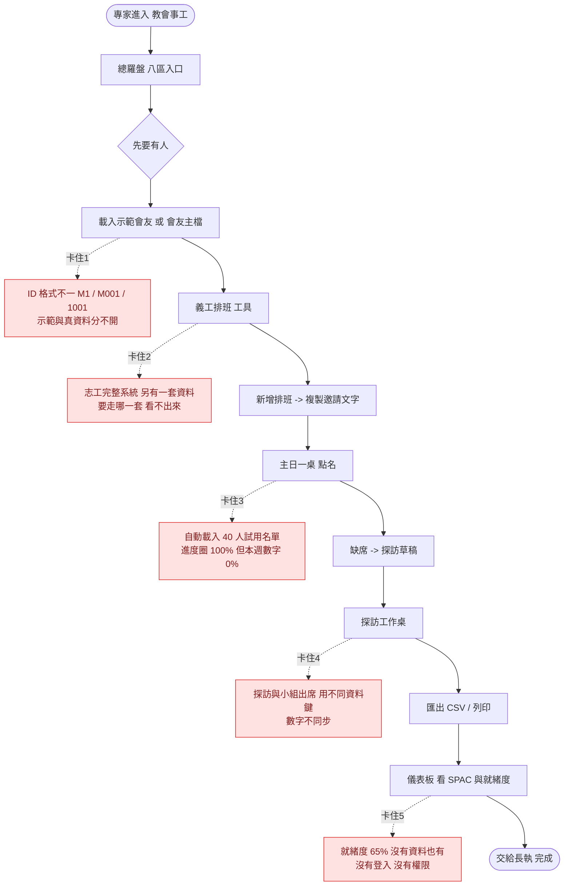

# 教會事工網站 · 獨立盲測報告（專家視角：ERP／CRM 系統分析師）

- 檢測範圍：`blind_input.md` 列出的 9 區、25 頁。
- 依據：只用截圖，加上各頁 HTML 前 300 行（短頁看前 50～150 行）。
- 限制：多數頁面超過 300 行，300 行之後的程式碼我沒讀。標「無法判斷」的項目，都是畫面與前 300 行看不到答案。
- 截圖是 file:// 開啟的畫面。多張截圖停在頁面中段，看不到頁首。
- 本報告是我「看到什麼就寫什麼」的結果，沒有參考任何作者結論。

---

## A. 頁面表

> 分數＝專家第一眼知道要按哪裡（1 很難～5 很清楚）。
> 嚴重度：P0 資料壞／洩漏；P1 主要功能不能用；P2 能用但易錯／看不懂；P3 小瑕疵。
> 區名用 `blind_input.md` 的名稱；頁面自己標的名稱不同時，在問題欄註明。

### 0 CRM 旅程／總羅盤

| 區 | 頁面 | 用途 | 第一眼 | 可完成任務？ | 問題（附證據） | 嚴重度 |
|---|---|---|---|---|---|---|
| 0 | `ai_tools/pages/crm_automation_console.html` | 口述／貼文字，規則解析成意圖草稿，再「開表單預填」。 | 4 | 部分 | ① 畫面說「AI 語音免填表助理」，原始碼進階區承認是「本機規則 demo（關鍵字）」，不是 AI。右上有「試用版・AI 模擬」徽章，算誠實，但標題誤導。② 頂部連結「Lab 總覽」「教會行政」用 `javascript:void(0)` + `labNav`／`window.parent.applyMode`，離開 iframe 單獨開啟時沒有作用。③ 全頁只預填、不存檔；表單端是否接得住，本頁看不到。④ 橫幅是簡體（「探访后口述 → AI 整理成表单字段草稿」），內文是繁體，簡繁混雜。 | P2 |
| 0 | `church_ministry/_landing/education.html`（C 教育培訓） | 區落地頁：點 Tab 節點，下方出現可進的頁面。 | 3 | 部分 | ① 要先點節點，下方才出現入口，等於多一步。② 頁名是「C 教育培訓」，清單區名是「聖經門訓」，同一區兩個名字。③「備課」節點的第三項「聖經研讀 跨模組」會離開本區，沒有標示。 | P3 |
| 0 | `church_ministry/guide_crm_trial_30min.html` | 檔案本身是 `meta refresh` 轉到 `_landing/gateway.html`（標題寫「舊 CRM 試玩已退役」）。截圖看到的是總羅盤「八區入口」。 | 3 | 部分 | ① 原始碼有「長執報告 ⬇ 頁面摘要 CSV／🖨 列印摘要」兩顆按鈕，實際只匯出 `title / h1 / path / exportedAt`，不是報告，是空殼。② 路徑 A／B／C 的 30 分鐘導覽在被轉走的頁面裡，使用者看不到。③ 八區入口卡片形狀不一（有的歪斜、有的圓角不規則），不像資料入口。④ 同一個 H 區，這裡叫「出席系統」，另一頁叫「出席」。 | P2 |

### A 敬拜音樂

| 區 | 頁面 | 用途 | 第一眼 | 可完成任務？ | 問題（附證據） | 嚴重度 |
|---|---|---|---|---|---|---|
| A | `_landing/worship.html`（頁名「A 崇拜聖樂」） | 主日步驟：工作桌 → 詩班 → 聖詩 → 回總羅盤。 | 4 | 部分 | ① 頁名「崇拜聖樂」，清單名「敬拜音樂」。② 把「回總羅盤」當成第 4 個步驟，混淆「做事」和「導覽」。③ 要先點步驟，下方才出現連結。 | P3 |
| A | `modules/worship/choir-team.html` | 詩班：聲部人數、組織、訓練、演出、活動、樂譜、七張事工流程表。 | 3 | 部分 | ① **P0**：`loadDemo()`／`seedChoirFlowDemo` 會在空資料時自動試填（頁面說明「首次開啟也會自動試填」）。截圖「培訓表」第一列「新團員 12 人／示範」，使用者分不出是示範還是真資料。② 同類頁 `instrument-team` 的原始碼是 `if (data.members.length===0) loadDemo()` 並寫回 localStorage，刪光示範成員後重整會再出現（見 B 節問題 1）。③ 簡繁混雜：「事工流程表（年度／导师／练习／编配…）」標題簡體，說明文字繁體。④ 頁面頂端固定列「← 15 主桌／回『敬拜團隊桌』」蓋住下方表格列。⑤ 團員用 `memberId`，但頁面只放了「會友主檔」連結，沒有看到真的選人欄位，下方「後期模組互聯（預告）」自己標明是預告，不是功能。⑥ 資料鍵 `church_ministry_choir_flow_v1`、`choir_score_refs_v1` 等直接寫在說明文字，只有匯出 CSV，沒有匯入與備份。 | P0 |
| A | `modules/worship/instrument-team.html` | 器樂團：成員、樂器、排班、曲目、事工流程。 | 3 | 部分 | ① **P0**：`DOMContentLoaded` 裡 `if (data.members.length === 0) loadDemo()`，`loadDemo()` 末尾 `localStorage.setItem('instrumentTeamData', …)`。使用者刪光示範成員，重整後示範資料又寫回去。② 截圖顯示樂器清單只有「刪除」，沒有編輯；原始碼的排班表也沒有操作欄。③ 成員的會友 ID 是手打文字（placeholder「例如：M001」），沒有跟會友主檔核對，對不上就各管各的。④ 圖表依賴外部 `cdn.jsdelivr.net/chart.js`；離線 file:// 沒網路時會怎樣，原始碼前 300 行看不出。⑤ 簡體介面（「乐器清单」「新增乐器」）。 | P0 |

### B 牧養小組

| 區 | 頁面 | 用途 | 第一眼 | 可完成任務？ | 問題（附證據） | 嚴重度 |
|---|---|---|---|---|---|---|
| B | `_landing/pastoral.html` | 關懷環：牧養整合、探訪、預警、豐盛金齡。 | 3 | 部分 | ① 卡片是不規則的「水滴」形狀，內容擠在角落。② 展開區出現「知情同意 W0」「失敗指標／停損 W0」「轉介資源 W1」，W0／W1 是內部波次代號，使用者不懂，也暗示尚未完成。③ 要先點節點才看到入口。 | P2 |
| B | `modules/fellowship/fellowship-circles.html` | 團契的圈：五個團契卡片、Hub 人數、CSV／列印。 | 4 | 部分 | ① 空白新資料卻有「社青職場圈 6 人／1 組」等數字，頁面載入時呼叫 `PastoralDataHub.ensurePastoralSeed(false)`，人數是種子資料。② 同一畫面簡繁混雜：「社青職場圈」繁體，「北区邻里圈」「长青关怀圈」簡體。③ 「北區鄰里圈」沒有人數（沒對到 `ageZone`），其他卡有，不一致。④「社青職場圈」與「夫婦團契」都連到同一個「小組工作桌」，使用者分不出差別。⑤ 頁面不能新增、修改團契，只有導覽與匯出。 | P2 |
| B | `modules/fellowship/index.html` | 團契互動模組首頁：功能卡片、概況、最近活動。 | 2 | 否 | ① 截圖整頁沒有版面樣式，像未套 CSS（原始碼引用 `assets/css/tailwind.min.css`、`fontawesome.min.css`，檔案是否存在我無法確認）。② 標題「Interaksi persekutuan」是印尼語，旁邊有簡短中文，語言切換顯示「中」卻出現印尼文。③ **假數字**：原始碼寫死 `totalGroups=3`、`totalMembers=47`、`monthlyVisits=8`、`completionRate=85%`，與同區「團契的圈」的 6／1／1 人對不上。④「小組管理」「探訪事工」「探訪報表」都標「已完成」，但 `goBack()`、`loadModule()` 的實作超出前 300 行，無法判斷。⑤「團契統計」寫「計劃中」，同區已有「聚会与出席统计」頁，兩個狀態矛盾。⑥「最近活動」是 2024 年的寫死資料。 | P1 |

### C 聖經門訓

| 區 | 頁面 | 用途 | 第一眼 | 可完成任務？ | 問題（附證據） | 嚴重度 |
|---|---|---|---|---|---|---|
| C | `ai_tools/sidebar_lab.html` | AI Lab 的左欄導覽（Prompt、創作、媒體、事工 AI）。 | 3 | 無法判斷 | ① 這是側欄片段，單獨開啟下半頁空白，不是完整頁面。② 簡繁混雜：「导读・备课」「创作・图音视频」是簡體，「會友・人找工」是繁體。③ 使用 `<base target="contentFrame">` 加 `data-b100-nav`，靠外層殼才會換右欄；單獨開啟時連結落點無法判斷。④ 內含連到 `outreach-integrated.html` 等其他區頁面，我沒有檔案可驗證。⑤ 「聖經門訓」區放 AI 輔助側欄，對「門訓」這個任務沒有直接關係。 | P2 |
| C | `bible_study/comprehensive_exegesis_reader.html` | 逐章釋經閱讀（創世記 2 章），含章節選擇、AI Prompt 下拉、音頻。 | 4 | 是 | ① 閱讀任務清楚，內容完整。② 簡繁並陳：外殼繁體，經文注解簡體（可能是原始內容，但使用者會看到兩種字）。③ 橫幅「讓完可回跑道打卡」疑似錯字（應為「讀」）。④ 右上角小按鈕字太小，我讀不準，意義不明。⑤ 音頻播放器 00:00，音檔是否存在無法判斷。⑥ 「AI Prompt…」下拉有「複製」按鈕，沒有看到可儲存筆記或進度的欄位，無閉環。 | P3 |
| C | `bible_study/sidebar.html` | 聖經研讀側欄：工作台、譯本對照、搜尋、各功能折疊。 | 3 | 無法判斷 | ① 側欄片段，單獨開啟只有左欄寬度的內容。② 提示條文字讀不通順（我讀成「總經選當用右欄工作台：釋經參讀用下方 66 卷選單」），且畫面下方看不到「66 卷選單」。③「地理歷史」區塊比其他區塊寬，版面不對齊。④「右欄點站點出發」意義不明。 | P2 |

### D 外展差傳

| 區 | 頁面 | 用途 | 第一眼 | 可完成任務？ | 問題（附證據） | 嚴重度 |
|---|---|---|---|---|---|---|
| D | `_landing/outreach.html` | 外展漏斗：需求登記 → 新人接待 → 交棒。 | 4 | 部分 | ① 漏斗圖像簡潔，但要先點節點。② 交棒只列出「B 牧養」「H 出席」兩項，沒說資料怎麼帶過去。 | P3 |
| D | `modules/expansion/outreach-strategy.html` | 登記社區需求 → 存本機 → 轉探訪 → 匯出 CSV／列印。 | 5 | 是（單向） | ① 本次盲測唯一在畫面上看得到「建立 → 查詢 → 交接 → 匯出」的頁面。② 只能「標記已結」，沒有編輯或刪除，打錯的紀錄改不了。③ 「M6 LIVE 鏈」「真鏈」是內部詞。④ 頁面承認「其餘 D 區子頁仍多為 DEMO，不進儀表板成熟度％」，但使用者不知道哪些是 DEMO。⑤ 列印用 `window.open` + `document.write`，被彈窗封鎖時只跳 `alert("無法開啟列印視窗")`。⑥ 頂端「D・外展差傳／回日常工作／本區完整側欄／載入試用會友」擠成一行小字。⑦ 資料不上儀表板（頁面自述 `不上 getCrmMaturitySummary`），主管在儀表板看不到。 | P2 |

### E 社會服務

| 區 | 頁面 | 用途 | 第一眼 | 可完成任務？ | 問題（附證據） | 嚴重度 |
|---|---|---|---|---|---|---|
| E | `_landing/social.html`（頁名「E 社關服事」） | 服事節點：義工排班 → 會眾入口 → 接牧養。 | 4 | 部分 | ① 頁名「社關服事」，清單名「社會服務」。② 節點形狀三種（長方、橢圓、藥丸）不一致。③ 「會眾入口 Church Center」意義不明。 | P3 |
| E | `modules/volunteer/volunteer-integrated.html` | 志工事工完整系統：崗位、配對、排班、培訓、績效。 | 3 | 部分 | ① **假圖表**：截圖「績效分析」頁「志工活躍度」「崗位飽和度」是空圖，但「服務時間分布」有 31／38／25／13 的柱狀；旁邊「需要關注」寫「所有志工服務狀態正常」，而此時沒有任何志工資料。使用者會誤以為有資料。② 空圖沒有空狀態提示，只有空座標。③ 頂端要求先「載入示範會友」才有名單，沒有直接新增會友的入口。④ 與 `tools/volunteer_shift` 是兩套志工系統（頁面自己寫「與義工排班工具互補」），各有各的資料來源，見 B 節問題 1。⑤ 圖表依賴外部 Chart.js CDN。⑥ 導覽按鈕「智能配對」等原始碼可見，但 1593 行後無法驗證。 | P1 |
| E | `tools/volunteer_shift/index.html` | 義工智能排班首頁：三步驟、驗收、KPI、新增排班、請假調班。 | 3 | 部分 | ① 版面主文是印尼語（「Dasbor pelayanan」「Jadwal relawan cerdas」），語言切換列同時有 中／EN／VI／ID。② 說「三步」，列表是 4 項，且編號顯示「1. 1.」「2. 2.」重複。③ 內部詞暴露：「Hub-canonical」「CTV」「UAT」「RACI」「W5 劇本」按鈕，使用者無法理解。④ 「資料來源 `volunteerSystemData.schedules`」「資料狀態 尚無資料／資料筆數 0／寫入行為 僅讀取，不會寫入」是開發診斷資訊，直接顯示在畫面。⑤ 首屏同時有「小白驗收」「傳承交接」「牧者試用」「三步」多個區塊，主要動作不突出。⑥ 「載入 A1 試用資料」會寫入 3 會友、2 崗位、2 排班、2 筆 CTV 建議（頁面自述），是否與真資料隔離，無法判斷。 | P2 |

### F 樂以載道

| 區 | 頁面 | 用途 | 第一眼 | 可完成任務？ | 問題（附證據） | 嚴重度 |
|---|---|---|---|---|---|---|
| F | `hymn_management/hymn_catalog_sort.html` | 1845 首聖詩曲譜表，可排序、篩選。 | 4 | 是（只讀） | ① 資料瑕疵：編號欄有「0145,」「0146,」「0149,」結尾逗號。② 歌名含重複編號與符號（「0145 Hosanna, Loud Hosanna ▲」）。③ 詩篇列標題含「0 PSALM_-103_1-13」類程式殘留字串。④ 「曲調」欄大量空白（—）。⑤ 簡繁混雜（「时已夜半橄榄山头」簡體，其他繁體）。⑥ 只讀，沒有匯出，也沒有「加入詩班曲目／敬拜流程」的按鈕。 | P2 |
| F | `hymn_management/practical_hymnology/landing.html` | 聖詩「唱／懂／活／服」工作卡總地圖。 | 3 | 部分 | ① 截圖頂端導覽列（「回 12 課主線」等）浮在內容上，把上方內容蓋住。② 暴露內部代號「hymn_most_0121」。③ 卡片（「聽這首譜」「投影歌詞」…）看不出是連結還是說明文字。④ 與詩班頁的曲目是各自的資料：詩班頁自己存 `choir_score_refs_v1`，沒有參照聖詩編號。 | P2 |

### G 規劃行政

| 區 | 頁面 | 用途 | 第一眼 | 可完成任務？ | 問題（附證據） | 嚴重度 |
|---|---|---|---|---|---|---|
| G | `church_ministry/dashboard.html` | 教會事工儀表板：SPAC、規劃回饋、KPI、就緒度。 | 2 | 部分 | ① 英文縮寫與內部詞過多：「Plan → Do」「Do → Plan · 週回饋（cross-risk → 規劃工具）」「PDCA」「SPAC」。② 開發診斷直接顯示：「KPI 契約 v1 · source=development_bridge · generated_at=… skipped(att=0,sch=0,inc=0,fin=0)」。③ 沒有資料卻顯示「會友資料就緒度 65%」「就緒度 65%」，來源無法判斷。④ 英文標籤「Dasbor data」（印尼語）與中文混用。⑤ 權限：橫幅寫「登入：本機模式（未強制 RBAC）。啟用 API 請設 cloud_config USE_API + REQUIRE_AUTH…」，等於本機沒有身分驗證。⑥ 頂端有十多個連結小膠囊（index_v5、全站工具說明、圖譜…），沒有主次。 | P1 |
| G | `modules/education/education-integrated.html` | 主日學工作桌：5 Tab（導覽／學籍／出席／門訓／備課），名冊匯入匯出。 | 4 | 是 | ① 本批唯一同時有「載入示範資料／匯出 JSON／匯入／名冊 CSV／出席 CSV／缺席預警 CSV／列印」的頁面，閉環最完整。② 空白新資料卻顯示 3 班級、15 學員，且「C↔學校 主日學 15/15 已連 memberId」，是自動種子，不是使用者資料。③ 同一頁疊兩層導覽列（外層「← 15 主桌」＋內層 iframe 又有「← 15 主桌」）。④ 「④ 備課」Tab 打開後顯示「教師·課程·目標／教師管理」，與落地頁「備課＝教材備課」不一致。⑤ 教師名簡繁混雜（「陈弟兄」「李姊妹」）。⑥ 會友 ID 是 `M1`、`M2`，與其他頁的 `M001`、`1001` 格式不同。 | P1 |
| G | `modules/fellowship/newcomer-qr-desk.html` | 新人發碼台：審核新人 → 發 QR → 重印。 | 4 | 是 | ① 權限靠畫面上的下拉選單（「可以發碼（負責人）／只看不發（招待）」），任何人都能自己切成負責人，不是真的權限。② 新人姓名、電話寫在 localStorage，頁面沒有隱私或保存期限說明，也沒有刪除入口。③ 語氣混用：廣東口語（「而家」「唔緊要」「呢張」「畀」）與一般繁體。④ 發碼失敗、角色不符都用 `alert()`。⑤ 新人 ID 是 `1001` 數字格式，與 `M1`、`M001` 又不同。⑥ 截圖是「試發示範碼」後的狀態，不是空白，無法看到真正的空狀態，但原始碼有空狀態卡。 | P1 |

### H 出席系統

| 區 | 頁面 | 用途 | 第一眼 | 可完成任務？ | 問題（附證據） | 嚴重度 |
|---|---|---|---|---|---|---|
| H | `_landing/attendance.html` | 出席步驟：報到 → 牧養出席 → 營運手冊 → 歸屬。 | 3 | 部分 | ① 副標題寫「三步做事」，卡片有 4 張；前三張沒有編號，只有第 4 張標「第4步・歸屬」。② 第 4 步的三個連結「金齡安全門／新人自助登記／認識小組」混在出席頁，主題發散。 | P3 |
| H | `modules/fellowship/pastoral-attendance.html` | 小組聚會與出席統計：小組下拉、Tab 匯報／走勢／預警／奉獻。 | 3 | 部分 | ① 簡繁混雜：標題「聚会与出席统计」簡體，下方「要登記？→ 現場點名」繁體。② 內部詞：「回測進度 0/4」「資料橋：group_attendance_v1」「摘要：docs/ATTENDANCE_GOVERNANCE.md」放在使用者畫面。③ 出席資料鍵是 `group_attendance_v1`，主日一桌用 `attendanceRecords`，主日學用另一套，見 B 節問題 1。④ 圖表依賴外部 Chart.js CDN。⑤ 同頁寫「小組／校區財務摘要（只讀，詳細編目在 E 區財務事工）」，但 E 區清單中沒有財務頁。 | P1 |
| H | `modules/worship/worship-sunday-desk.html` | 主日一桌：點名 → 缺席跟進 → 本週數字 → 匯出。 | 4 | 部分 | ① 截圖上方進度圈 100%、提示「已全標出席・記得按存檔」，下方「本週數字」卻是 0%（尚未存檔），兩個數字同畫面打架。② 原始碼提示「自動喺空庫時載入」約 40 人試用名單；成員來源有三個後備（`ChurchDataBridge.getMembers`、`churchMembers`、`memberSystemData`），不知道實際用哪一個。③ 「回測進度」是測試用語。④ 內部資料鍵 `attendanceRecords` 直接寫在畫面。⑤ 說明寫「小組點名請用 B 簽到台」，一個教會要用兩個簽到台。⑥ 「全部缺席 → 探訪草稿」寫入本機探訪清單，與 B 區探訪是否同一份，無法判斷。 | P1 |

---

## B. 最嚴重的 3 個問題與重現

### 問題 1（P0）：空庫自動塞示範資料，加上人員與出席多套各管各的

**證據**
- `instrument-team.html` 第 140～146 行：`const saved = localStorage.getItem('instrumentTeamData'); if (saved) data = JSON.parse(saved); … if (data.members.length === 0) loadDemo();`。`loadDemo()` 結尾 `localStorage.setItem('instrumentTeamData', …)` 寫入示範成員（李弟兄、王姊妹、張弟兄）。
- `choir-team.html` 頁面說明「首次開啟也會自動試填」，截圖「培訓表」第一列即「新團員 12 人／示範」。
- `worship-sunday-desk.html` 提示「自動喺空庫時載入」約 40 人。
- 同一個人在各頁的 ID 格式不同：主日學 `M1`、器樂 `M001`（手打）、新人發碼台 `1001`。
- 出席資料至少三套：`attendanceRecords`（主日一桌）、`group_attendance_v1`（小組出席）、主日學出席（education）。

**重現**
1. 清除瀏覽器站台資料，用 file:// 開 `instrument-team.html`，會看到 3 位示範成員。
2. 在「成員」頁刪光 3 人，按 F5，示範成員回來，而且再次寫入 localStorage。
3. 開 `education-integrated.html`（空白新資料），會看到「3 班級／15 學員」。
4. 在 `worship-sunday-desk.html` 勾「全出席」，再開 `pastoral-attendance.html` 看同一人，數字不會同步（兩邊鍵不同）。

**後果**：真實資料與示範資料混在一起，無法區分、無法清空，出席率與人數會失真。

### 問題 2（P1）：寫死的假數字與「看起來正常」的空圖

**證據**
- `modules/fellowship/index.html` 原始碼：`totalGroups=3`、`totalMembers=47`、`monthlyVisits=8`、`completionRate=85%`；同區「團契的圈」顯示 6／1／1 人。
- `volunteer-integrated.html` 截圖：前兩張圖是空座標，「服務時間分布」卻有 31／38／25／13 的柱狀，旁邊寫「所有志工服務狀態正常」，此時沒有志工資料。
- `dashboard.html` 截圖：無資料卻顯示「就緒度 65%」。

**重現**
1. 清除站台資料。
2. 開 `fellowship/index.html`，直接看到 47 人、85% 完成率。
3. 開 `volunteer-integrated.html`，切到「績效分析」，看到有數值的柱狀圖與「狀態正常」。

**後果**：主管依這些數字做決策，會被誤導。

### 問題 3（P1）：沒有真正的權限，個資只存瀏覽器

**證據**
- `dashboard.html` 橫幅：「登入：本機模式（未強制 RBAC）」。
- `newcomer-qr-desk.html`：「可以發碼／只看不發」是前端下拉選單，任何人都能改。
- 新人姓名、電話寫入 localStorage（發碼台載入 `newcomer_qr_store.js`、`attendance_checkin_store.js`）。
- 除主日學頁有「匯出 JSON／匯入」外，我看到的其他頁面只有 CSV 匯出，沒有看到匯入或還原。

**重現**
1. 開 `newcomer-qr-desk.html`，把「我係」改成「可以發碼（負責人）」，就能發碼。
2. 清除瀏覽器資料，所有紀錄消失，且沒有還原入口（教育頁除外）。

**後果**：共用電腦上，任何人都能看到與操作敏感資料，且備份靠使用者自己想到。

---

## C. 各區評分（0 與 A–H，1～10 分）

| 區 | 分數 | 一句話理由 |
|---|---|---|
| 0 CRM 旅程／總羅盤 | 5 | 導覽與 AI 標示誠實，但 30 分鐘導覽頁已被轉走，「報告」按鈕只匯出頁面標題，部分是空殼。 |
| A 敬拜音樂 | 3 | 詩班、器樂各自存資料並自動塞示範，刪不乾淨，會友 ID 靠手打，簡繁混雜。 |
| B 牧養小組 | 3 | 首頁沒有樣式又有寫死假數字，團契圈內人數來自種子，三頁數字互相對不上。 |
| C 聖經門訓 | 4 | 閱讀頁本身很好用；其餘兩項是側欄片段，單獨看不到任何「門訓」任務。 |
| D 外展差傳 | 6 | 唯一完整的「建立→查詢→交接→匯出」單向鏈，但缺編輯／刪除，也不進儀表板。 |
| E 社會服務 | 3 | 兩套志工系統重疊，圖表給出假數字，排班頁露出印尼語與內部術語。 |
| F 樂以載道 | 4 | 曲目庫大、可排序，但資料有程式殘留、沒有匯出，也沒有連到詩班或敬拜流程。 |
| G 規劃行政 | 5 | 主日學工作桌的匯入匯出最完整；儀表板內部詞過多、就緒度來源不明、沒有權限。 |
| H 出席系統 | 4 | 三個頁面各有各的出席資料，數字打架，簽到台也不只一個。 |

**整體分數：4.2 / 10**
（我只看到 25 頁，主要功能的實作多在原始碼 300 行之後，所以分數偏保守。）

**我最不放心的一件事**：同一個人在各頁是不同的 ID，空資料時又會被自動塞進示範資料。這會讓匯出的名冊、出席率、探訪名單全部不可信，而且使用者看不出來。

---

## D. 專家應該怎麼走（Mermaid）

典型任務：「上線前建立真資料 → 排一次志工 → 記主日出席 → 缺席轉探訪 → 匯出給長執」。

---

## E. 無法判斷、需要真人驗證的事項

1. 空白新資料時，`ensurePastoralSeed`、`loadDemo` 寫入的是否為同一份種子，清除後能否恢復到真正空白。
2. 在器樂、詩班頁把示範資料全刪，重整後是否真的回來（我只讀程式，沒有執行）。
3. `fellowship/index.html` 缺少樣式的原因：`assets/css/tailwind.min.css`、`fontawesome.min.css` 是否存在，離線 file:// 是否一樣。
4. `loadModule()`、`goBack()`、`showComingSoon()` 實際行為，以及「已完成」標示的功能到底能不能用。
5. 離線 file:// 沒網路時，使用 Chart.js CDN 的頁面（器樂、志工、小組出席、主日一桌圖表）是否整頁壞掉。
6. 同一個人在主日學（`M1`）、器樂（`M001`）、新人發碼（`1001`）之間，是否真有轉換對照。
7. 主日一桌的「全部缺席 → 探訪草稿」與 B 區探訪工作桌是否是同一份資料。
8. 各落地頁卡片「W0／W1」項目是否為可點的有效頁面，還是未建置的占位。
9. 側欄 `sidebar_lab.html`、`bible_study/sidebar.html` 在總站殼內實際運作與換右欄是否正常。
10. `crm_automation_console` 的「開啟表單並預填」在目標表單端是否真的把值填進欄位。
11. 新人發碼台的 QR 掃描端（門口簽到）是否真的認得短碼，以及重複掃描、過期的處理。
12. 音檔、外部連結（下載 APP／電子版）離線時的行為，以及 `comprehensive_exegesis_reader` 右上角小按鈕的真正文字。
13. 匯入功能：除主日學頁外，其他頁面是否有還原入口，我在前 300 行沒看到。
14. 簡繁、印尼語混用，是語言切換的預期行為，還是翻譯包載入失敗造成。
15. 多人同時使用（同一台電腦不同使用者、或不同瀏覽器）時，localStorage 資料是否會互相覆蓋。
