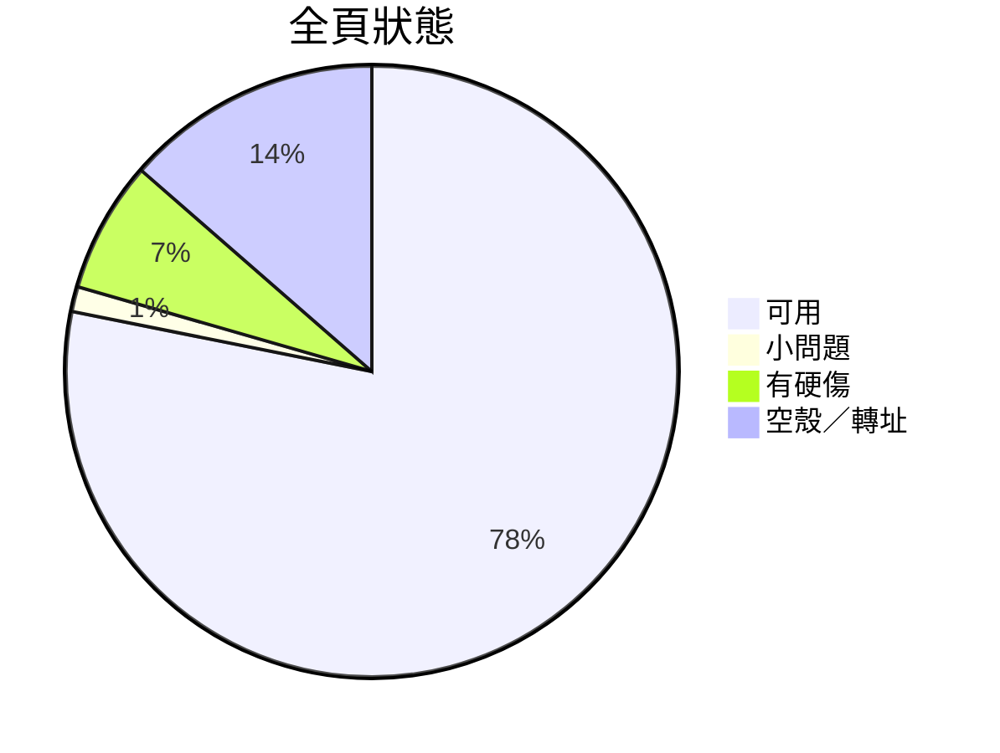

# 教會事工 0＋A–H · 全頁靜態掃描報告（階段 1）

> 自動產生（`cm_zone_scan.py`）。**靜態**＝只讀檔案，查連結、腳本、語法、空殼；**不代表好不好用**。逐頁實際操作是階段 2。

- 掃描頁數：**302**（含選單指到的他模組頁 19 頁）
- 語法檢查：已執行（Node）
- 圖例：✅ 無明顯問題　🟡 小問題　❌ 有 P0／P1　⚪ 空殼或只轉址

## 1. 總覽

| 區 | 頁數 | ✅ | 🟡 | ❌ | ⚪ | P0 | P1 | P2 | P3 |
|---|---|---|---|---|---|---|---|---|---|
| 0 CRM 旅程 | 54 | 47 | 0 | 0 | 7 | 0 | 0 | 0 | 27 |
| A 敬拜音樂 | 7 | 7 | 0 | 0 | 0 | 0 | 0 | 0 | 4 |
| B 牧養小組 | 57 | 46 | 0 | 10 | 1 | 13 | 0 | 0 | 63 |
| C 聖經門訓 | 29 | 21 | 1 | 1 | 6 | 1 | 0 | 1 | 20 |
| D 外展差傳 | 15 | 12 | 1 | 0 | 2 | 0 | 0 | 2 | 14 |
| E 社會服務 | 18 | 13 | 0 | 4 | 1 | 5 | 0 | 0 | 17 |
| F 樂以載道 | 7 | 6 | 0 | 1 | 0 | 1 | 12 | 0 | 4 |
| G 規劃行政 | 53 | 36 | 0 | 2 | 15 | 3 | 0 | 1 | 40 |
| H 出席系統 | 3 | 3 | 0 | 0 | 0 | 0 | 0 | 0 | 1 |
| 未歸區 | 59 | 45 | 2 | 3 | 9 | 0 | 11 | 3 | 69 |

嚴重度：P0＝壞掉／繞過橋接層　P1＝連結斷、雲端會壞　P2＝困惑或不一致　P3＝小瑕疵。

## 2. 問題類型排行

| 問題 | 嚴重度 | 件數 | 涉及頁數 |
|---|---|---|---|
| JS 語法錯誤 | P0 | 15 | 15 |
| 引用的腳本檔不存在 | P0 | 8 | 8 |
| 連結指向不存在的頁 | P1 | 23 | 4 |
| 空連結（# 或 javascript:void） | P2 | 3 | 3 |
| 示意／規劃中字樣偏多 | P2 | 2 | 2 |
| 缺 meta charset（file:// 可能亂碼） | P2 | 2 | 2 |
| 從任何入口都走不到（疑似舊檔） | P3 | 83 | 83 |
| 圖片／樣式檔不存在 | P3 | 64 | 34 |
| 簡體字偏多 | P3 | 42 | 42 |
| 只做轉址 | P3 | 40 | 40 |
| 少量示意字樣 | P3 | 23 | 23 |
| 重複 id | P3 | 5 | 5 |
| 沒有 title | P3 | 2 | 2 |

## 2b. 共用腳本語法檢查（`js/`、`church_ministry/js/`、`church_planning/js/` 共 318 支）

- ❌ `js/global_nav.js`：Invalid or unexpected token
- ❌ `church_planning/js/urgency_matrix_viz.js`：Invalid or unexpected token

## 3. 選單懸空項（選單有、檔案沒有）

- 無

## 4. 需優先處理：❌ 且使用者走得到（1 頁）

從選單、頂欄、側欄一路點得到的頁，壞了使用者會直接遇到。

| 區 | 頁面 | 問題 |
|---|---|---|
| F | `hymn_management/hymn/default.htm` | P0 引用的腳本檔不存在（hymn_enhancement_main.js）；P1 連結指向不存在的頁×12；P3 少量示意字樣（2 處）；P3 簡體字偏多（439 字） |

## 4b. ❌ 但從任何入口都走不到（20 頁，疑似舊檔）

建議由牧者決定：下架／改成只轉址／真的要用再修。不急。

| 區 | 頁面 | 問題 |
|---|---|---|
| B | `church_ministry/modules/care/care-ministry.html` | P3 圖片／樣式檔不存在×2；P0 JS 語法錯誤（Invalid or unexpected token）；P3 從任何入口都走不到（疑似舊檔） |
| B | `church_ministry/modules/fellowship/activity-management.html` | P3 圖片／樣式檔不存在×2；P0 引用的腳本檔不存在（assets/js/chart.min.js）；P0 JS 語法錯誤（Invalid or unexpected token）；P3 從任何入口都走不到（疑似舊檔） |
| B | `church_ministry/modules/fellowship/community-forum.html` | P3 圖片／樣式檔不存在×2；P0 JS 語法錯誤（Invalid or unexpected token）；P3 從任何入口都走不到（疑似舊檔） |
| B | `church_ministry/modules/fellowship/groups-reports.html` | P3 圖片／樣式檔不存在×2；P0 引用的腳本檔不存在（assets/js/chart.min.js）；P0 JS 語法錯誤（Invalid or unexpected token）；P3 從任何入口都走不到（疑似舊檔） |
| B | `church_ministry/modules/fellowship/groups.html` | P3 圖片／樣式檔不存在×2；P0 JS 語法錯誤（Invalid or unexpected token）；P3 從任何入口都走不到（疑似舊檔） |
| B | `church_ministry/modules/fellowship/photo-album.html` | P3 圖片／樣式檔不存在×2；P0 JS 語法錯誤（Invalid or unexpected token）；P3 從任何入口都走不到（疑似舊檔） |
| B | `church_ministry/modules/fellowship/visitation-ministry.html` | P3 圖片／樣式檔不存在×2；P0 JS 語法錯誤（Invalid or unexpected token）；P3 從任何入口都走不到（疑似舊檔） |
| B | `church_ministry/modules/fellowship/visitation-reports.html` | P3 圖片／樣式檔不存在×2；P0 引用的腳本檔不存在（assets/js/chart.min.js）；P0 JS 語法錯誤（Invalid or unexpected token）；P3 從任何入口都走不到（疑似舊檔） |
| B | `church_ministry/modules/support/system-integration.html` | P3 圖片／樣式檔不存在×2；P0 引用的腳本檔不存在（assets/js/chart.min.js）；P3 從任何入口都走不到（疑似舊檔） |
| B | `church_ministry/modules/support/visitation-care.html` | P0 引用的腳本檔不存在（../../js/simple_database_system.js）；P3 簡體字偏多（86 字）；P3 從任何入口都走不到（疑似舊檔） |
| C | `church_ministry/modules/education/education-management.html` | P3 圖片／樣式檔不存在×2；P0 JS 語法錯誤（Invalid or unexpected token）；P3 從任何入口都走不到（疑似舊檔） |
| E | `church_ministry/modules/activity/activity-management.html` | P3 圖片／樣式檔不存在×2；P0 引用的腳本檔不存在（assets/js/chart.min.js）；P0 JS 語法錯誤（Invalid or unexpected token）；P3 從任何入口都走不到（疑似舊檔） |
| E | `church_ministry/modules/activity/activity-reports.html` | P3 圖片／樣式檔不存在×2；P0 JS 語法錯誤（Invalid or unexpected token）；P3 從任何入口都走不到（疑似舊檔） |
| E | `church_ministry/modules/volunteer/volunteer-management.html` | P3 圖片／樣式檔不存在×2；P0 JS 語法錯誤（Invalid or unexpected token）；P3 從任何入口都走不到（疑似舊檔） |
| E | `church_ministry/modules/volunteer/volunteer-reports.html` | P3 圖片／樣式檔不存在×2；P0 JS 語法錯誤（Invalid or unexpected token）；P3 從任何入口都走不到（疑似舊檔） |
| G | `church_ministry/modules/finance/finance-management.html` | P3 圖片／樣式檔不存在×2；P0 JS 語法錯誤（Invalid or unexpected token）；P3 從任何入口都走不到（疑似舊檔） |
| G | `church_ministry/modules/finance/finance-reports.html` | P3 圖片／樣式檔不存在×2；P0 引用的腳本檔不存在（assets/js/chart.min.js）；P0 JS 語法錯誤（Invalid or unexpected token）；P3 從任何入口都走不到（疑似舊檔） |
| ? | `church_ministry/_templates/tool-kit/index.html` | P1 連結指向不存在的頁×2 |
| ? | `church_ministry/_templates/tool-kit/uat.html` | P1 連結指向不存在的頁（../uat_index.html）；P3 少量示意字樣（2 處） |
| ? | `church_ministry/audit/ae_module_audit_dashboard.html` | P1 連結指向不存在的頁×8；P2 示意／規劃中字樣偏多（12 處）；P3 簡體字偏多（88 字） |

## 5. 空殼／只轉址頁（⚪）

| 區 | 頁面 | 文字量 | 備註 |
|---|---|---|---|
| 0 | `church_ministry/_landing/fellowship.html` | 28 字 | 只轉址 |
| ? | `church_ministry/_landing/golden_age.html` | 27 字 | 只轉址 |
| ? | `church_ministry/desks/admin.html` | 46 字 | 只轉址 |
| ? | `church_ministry/desks/index.html` | 44 字 | 只轉址 |
| ? | `church_ministry/desks/outreach.html` | 42 字 | 只轉址 |
| ? | `church_ministry/desks/pastoral.html` | 44 字 | 只轉址 |
| ? | `church_ministry/desks/worship-team.html` | 40 字 | 只轉址 |
| G | `church_ministry/docs/ATTENDANCE_OPS_HANDBOOK.html` | 0 字 | 幾乎沒有內容 |
| 0 | `church_ministry/guide_crm_for_leaders.html` | 40 字 | 只轉址 |
| 0 | `church_ministry/guide_crm_for_teachers.html` | 31 字 | 只轉址 |
| 0 | `church_ministry/guide_crm_from_learning.html` | 35 字 | 只轉址 |
| C | `church_ministry/guide_crm_journey_hub.html` | 104 字 | 只轉址 |
| ? | `church_ministry/index_c_education_journey.html` | 56 字 | 只轉址 |
| D | `church_ministry/mission/disciple_center.html` | 237 字 | 只轉址 |
| G | `church_ministry/modules/analytics/activity-performance.html` | 50 字 | 只轉址 |
| G | `church_ministry/modules/analytics/activity-statistics.html` | 50 字 | 只轉址 |
| G | `church_ministry/modules/analytics/advanced-reports.html` | 50 字 | 只轉址 |
| G | `church_ministry/modules/analytics/effectiveness-trends.html` | 50 字 | 只轉址 |
| G | `church_ministry/modules/analytics/financial-statistics.html` | 50 字 | 只轉址 |
| G | `church_ministry/modules/analytics/growth-trends.html` | 50 字 | 只轉址 |
| G | `church_ministry/modules/analytics/index.html` | 50 字 | 只轉址 |
| G | `church_ministry/modules/analytics/member-statistics.html` | 50 字 | 只轉址 |
| G | `church_ministry/modules/analytics/ministry-performance.html` | 50 字 | 只轉址 |
| G | `church_ministry/modules/analytics/participation-trends.html` | 50 字 | 只轉址 |
| G | `church_ministry/modules/analytics/performance-evaluation.html` | 50 字 | 只轉址 |
| G | `church_ministry/modules/analytics/statistical-reports.html` | 50 字 | 只轉址 |
| G | `church_ministry/modules/analytics/trend-analysis.html` | 50 字 | 只轉址 |
| G | `church_ministry/modules/analytics/volunteer-performance.html` | 50 字 | 只轉址 |
| 0 | `church_ministry/modules/development/development-plan.html` | 29 字 | 只轉址 |
| C | `church_ministry/modules/development/spiritual-growth-tracking.html` | 114 字 | 只轉址 |
| C | `church_ministry/modules/education/spiritual-growth.html` | 29 字 | 只轉址 |
| C | `church_ministry/modules/education/sunday-school.html` | 26 字 | 只轉址 |
| D | `church_ministry/modules/expansion/cross-cultural-ministry.html` | 184 字 | 只轉址 |
| B | `church_ministry/modules/fellowship/pastoral_visitation_panel.html` | 198 字 | 只轉址 |
| ? | `church_ministry/modules/innovation/new-media-ministry.html` | 146 字 | 只轉址 |
| 0 | `church_ministry/modules/worship/attendance-management.html` | 26 字 | 只轉址 |
| 0 | `church_ministry/modules/worship/worship-reports.html` | 35 字 | 只轉址 |
| ? | `church_ministry/sidebar_c_education_journey.html` | 73 字 | 只轉址 |
| E | `church_ministry/workbenches/dept_E_admin.html` | 73 字 | 只轉址 |
| C | `ai_tools/tools/bible_prompt_generator.html` | 37 字 | 只轉址 |
| C | `school_management/dashboard.html` | 29 字 | 只轉址 |

## 5b. 靠腳本繪出內容的頁（靜態看不到畫面，階段 2 必須動態檢查）

| 區 | 頁數 |
|---|---|
| 0 CRM 旅程 | 25 |
| A 敬拜音樂 | 2 |
| B 牧養小組 | 28 |
| C 聖經門訓 | 13 |
| D 外展差傳 | 8 |
| E 社會服務 | 9 |
| F 樂以載道 | 4 |
| G 規劃行政 | 16 |
| H 出席系統 | 1 |
| 未歸區 | 34 |

## 6. 🟡 小問題（只列前 60 頁；完整見 CSV）

| 區 | 頁面 | 問題 |
|---|---|---|
| ? | `church_ministry/dashboard_church_layout_v1_content.html` | P3 圖片／樣式檔不存在×2；P2 示意／規劃中字樣偏多（4 處） |
| ? | `church_ministry/docs/qa_tracker_0af.html` | P2 空連結（# 或 javascript:void）（2 個） |
| D | `church_ministry/modules/mission/mission-reports.html` | P3 沒有 title；P2 缺 meta charset（file:// 可能亂碼）；P3 從任何入口都走不到（疑似舊檔） |
| C | `bible_study/comprehensive_exegesis_reader.html` | P2 空連結（# 或 javascript:void）（2 個） |

## 7. 自我測試

- 掃描器自測：`church_ministry/tests/test_cm_zone_scan.py`（9 項，含『故意放壞頁』驗證每種問題都抓得到、選單頁全數掃到、結果可重現）。

## 8. 下一步

1. 看 §4、§5，決定哪些要修、哪些該下架或標「示意」。
2. 階段 2：從 ❌ 最多的區開始，逐頁實際開起來操作。
3. 完整表：`church_ministry/audit/zone_scan_dashboard.html`（雙擊可開、可篩選）。